# Chapter 1 · Introduction & Analytical Framework: Welfare States When AI Compresses Labor Income

---

## 1. Technological Divergence and the Structural Challenge to the Spanish Welfare State

Modern European welfare states were constructed on the foundational assumption of full-time, stable wage employment [@van-parijs-vanderborght-2017; @van-parijs-vanderborght-2017]. In Bismarckian social insurance systems such as Spain's, entitlement to healthcare, unemployment protection, and retirement pensions is structurally linked to contributory payroll taxes (*cotizaciones sociales*) levied on formal labor earnings [@boe-ce-1978; @boe-trlgss-2015]. When technological change complements human cognitive capabilities, labor demand expands alongside productivity, preserving the wage bill and financing public redistribution [@acemoglu-restrepo-2019; @acemoglu-restrepo-2019].

The emergence of frontier generative artificial intelligence, agentic foundation models, and scalable autonomous software fundamentally breaks this historical complementarity [@eloundou-2024-gpts; @acemoglu-2024-macro-ai; @korinek-suh-2024]. Unlike 20th-century mechanization—which automated manual, repetitive physical tasks while shifting labor toward clerical, analytical, and managerial roles—AI directly substitutes for human cognitive, linguistic, and analytical labor across a wide spectrum of professions [@webb-2020-ai; @felten-2021-aioe; @gmyrek-ilo-2023]. In Spain, this shock interacts with deep-seated institutional vulnerabilities:
1. **Persistent Structural Unemployment and Labor Duality:** Spain's unemployment rate has averaged 16.4% over the past four decades, consistently exceeding the Eurozone benchmark by 6 to 9 percentage points [@bentolila-2012-dual-spain]. Labor duality between highly protected indefinite contracts and precarious temporary or involuntary part-time work concentrates technological displacement risks among younger cohorts, women, and mid-tier service workers.
2. **Fiscal Reliance on Payroll Levies:** Social Security contributions account for approximately 34.5% of total tax revenue in Spain, representing 12.8% of GDP—significantly above the OECD average [@almunia-lopez-rodriguez-2019-eti]. A compression of the aggregate labor income share directly undermines the primary revenue engine of the Spanish welfare system.
3. **The Operational Failure of Means-Tested Safety Nets:** Introduced in 2020, Spain's *Ingreso Mínimo Vital* (IMV [@boe-imv-2021]) was intended as a permanent non-contributory floor. However, official evaluations by Spain's Independent Fiscal Authority (*Autoridad Independiente de Responsabilidad Fiscal*, AIReF [@airef-opinion-imv-2023; @airef-opinion-imv-2024]) document that 56% of eligible households living in severe poverty never access the benefit, while non-take-up reaches 70% for the child poverty supplement (*Complemento de Ayuda para la Infancia*, CAPI). Furthermore, ex-post means testing and retrospective income audits generate widespread administrative overpayment recovery orders (*cobros indebidos*), precipitating severe liquidity distress for vulnerable families.

Faced with structural labor income compression, piecemeal adjustments to means-tested schemes cannot preserve living standards. A fundamental redesign of social transfer architecture is required.

---

## 2. Conceptual Taxonomy: UBR vs. IMV vs. Negative Income Tax

To establish analytical clarity, this monograph rigorously distinguishes between three competing transfer architectures [@van-parijs-vanderborght-2017; @hoynes-rothstein-2019; @ghatak-maniquet-2019]:

```mermaid
flowchart TD
    subgraph UBR["Universal Basic Rent (UBR / RBU)"]
        U1["Universal ex-ante eligibility<br/>(Every adult resident receives transfer)"]
        U2["Strict individual entitlement<br/>(No cohabitation or household unit tests)"]
        U3["Unconditional monthly disbursement<br/>(SEPA credit on the 1st of each month)"]
        U4["IRPF tax-transfer integration<br/>(Progressive net clawback at higher incomes)"]
        U1 --> U2 --> U3 --> U4
    end

    subgraph IMV["Guaranteed Minimum Income (IMV)"]
        I1["Means-tested eligibility<br/>(Prior-year income & wealth thresholds)"]
        I2["Household / cohabitation unit unit<br/>(Complex joint family definitions)"]
        I3["Severe phase-out rates<br/>(Near-100% METRs creating poverty traps)"]
        I4["Retrospective clawbacks<br/>(Cobros indebidos & 56% non-take-up)"]
        I1 --> I2 --> I3 --> I4
    end

    subgraph NIT["Negative Income Tax (NIT)"]
        N1["Annual tax filing disbursement<br/>(Rebate delivered after fiscal year-end)"]
        N2["Household income basis<br/>(Joint tax-return calibration)"]
        N3["Marginal phase-out rate t<br/>(Transfer = G - t * Y)"]
        N4["Intra-household opacity<br/>(Benefits captured by primary earner)"]
        N1 --> N2 --> N3 --> N4
    end
```

### A. Universal Basic Rent (UBR / *Renta Básica Universal*)
Defined under Decision `D-001` as an unconditional, periodic (monthly), individual cash transfer paid in euros to all qualifying residents without means testing or work requirements. While gross disbursements are strictly universal ex ante, UBR is integrated into the Personal Income Tax (*Impuesto sobre la Renta de las Personas Físicas*, IRPF [@boe-irpf-2006]) via an individual refundable tax credit (*Deducción Reembolsable Universal*). Consequently, upper-income earners contribute more in reformed taxes than they receive in gross transfers, making them net contributors ex post. Crucially, UBR treats the individual—not the cohabiting family—as the sovereign unit of welfare, eliminating bureaucratic scrutiny into cohabitation and safeguarding intra-household financial autonomy for women and dependent adults [@van-parijs-vanderborght-2017].

### B. Guaranteed Minimum Income (*Ingreso Mínimo Vital* & *Rentas Mínimas Autonómicas*)
Targeted, means-tested cash assistance conditioned on prior-year declared income and wealth thresholds below statutory poverty ceilings [@boe-imv-2021]. By withdrawing €1 of benefit for every €1 of net earned income (or applying steep tapering schedules), minimum income schemes impose marginal effective tax rates (METRs) approaching 100%, generating acute poverty and inactivity traps. Furthermore, verifying cohabitation networks creates immense administrative friction, resulting in extensive non-take-up and retrospective debt notifications.

### C. Negative Income Tax (NIT)
Originally formulated by Friedman [@ghatak-maniquet-2019], the NIT provides a guaranteed cash floor ($G$) that phases out at a constant marginal tax rate ($t$) as income ($Y$) increases: $\text{Transfer} = G - t \cdot Y$. While mathematically isomorphic to a UBR paired with a flat income tax in static annual budget terms [@saez-2002-optimal-transfers; @ghatak-maniquet-2019], the NIT differs markedly in real-world administrative delivery:
1. **Disbursement Frequency & Liquidity:** NIT is conventionally settled through annual income tax returns, leaving low-income households liquidity-constrained throughout the fiscal year. UBR provides liquid cash on the 1st of every month.
2. **Intra-Household Allocation:** NIT rebates are typically captured by the primary tax filer, obscuring intra-household inequality. Individualized UBR guarantees direct personal bank deposits to each adult.
3. **Take-Up and Stigma:** Universal enrollment bypasses the stigma and documentation costs inherent in income-tested tax credits, routinely lifting take-up above 98%.

---

## 3. Empirical Baseline: What International and Spanish Trials Teach Us

The empirical design of this monograph is grounded in rigorous causal evidence from recent guaranteed income experiments across advanced and developing economies [@van-parijs-vanderborght-2017; @hoynes-rothstein-2019]:

| Trial / Program | Sample & Design | Monthly Transfer | Key Empirical Findings | Causal Reference |
|---|---|---|---|---|
| **OpenResearch Guaranteed Income Study (US)** | $N = 3,000$ randomized low-income adults (1,000 treated, 2,000 control) across Illinois and Texas (36 months). | \$1,000/mo unconditional cash | Labor hours decreased modestly by $-1.3\text{ h/wk}$ ($-3.9\%$). Beneficiaries prioritized job search quality, training (+14%), and healthcare utilization. Zero increase in substance abuse or wasteful consumption. | [@vivalt-2024-openresearch; @bartik-2024-openresearch; @miller-2024-openresearch-health] |
| **Finland Basic Income Experiment** | $N = 2,000$ nationwide unemployed individuals aged 25–58 (24 months, administrative data). | €560/mo unconditional (replacing basic unemployment) | Mildly positive employment effect (+6 days/year worked). Statistically significant improvements in mental health, life satisfaction, cognitive functioning, and institutional trust. Zero negative labor supply elasticity. | [@kangas-2021-finland] |
| **Stockton Economic Empowerment Demonstration (SEED)** | $N = 125$ randomized residents in neighborhoods below median income (24 months). | \$500/mo unconditional | Full-time employment increased from 28% at baseline to 40% at Year 1 (vs. +5% in control). Marked reduction in month-to-month income volatility and anxiety. | [@west-2024-seed] |
| **GiveDirectly Universal Basic Income Trial (Kenya)** | $N = 29,000$ individuals across 295 rural villages (12-year longitudinal trial). | ~\$22/mo (PPP floor) | Village-level cash transfers generated a local general-equilibrium fiscal multiplier of $1.52\times$. Positive spillovers onto non-recipients, modest price inflation ($\le 0.1\%$). | [@egger-2022-ge-kenya; @banerjee-niehaus-suri-2019] |
| **Barcelona B-MINCOME Trial (Spain)** | $N = 1,000$ vulnerable households across 10 deprived neighborhoods in Besòs river basin (24 months). | €400 to €1,675/mo (comparing conditional vs. unconditional arms) | Unconditional cash arms achieved 25% higher subjective well-being and reduced mental distress compared to conditional workfare arms. Low labor market withdrawal. | [@todeschini-bmincome-2020] |
| **Alaska Permanent Fund Dividend (APFD)** | Universal state population ($N \approx 730,000$) since 1982. | \$1,000 to \$3,200/year unconditional dividend from oil fund | Cash transfers had no adverse effect on aggregate employment. Part-time employment increased by 1.8 percentage points, driven by local consumption demand externalities. | [@jones-marinescu-2022] |

### Critical Methodological Limitations of Past Trials & The General-Equilibrium Financing Wedge
Despite their rich insights, existing micro-trials suffer from five foundational methodological boundaries that prevent naive direct extrapolation to nationwide policy:
1. **The General-Equilibrium Financing Wedge:** Microeconomic randomized trials (RCTs) evaluate temporary, unfinanced cash windfalls disbursed to an infinitesimal treatment subset within an undisturbed local economy [@chetty-2012-bounds]. Treatment recipients in pilots face an isolated unearned *income effect* while bearing zero liability for the macro-fiscal tax extraction required to finance the scheme; local consumer prices, aggregate labor supply, and market-clearing wages remain exogenous. In contrast, a nationwide, tax-financed UBR requires substantial tax extraction (progressive IRPF withholding, corporate surplus contributions), exposing workers simultaneously to an unearned income effect *and* an elevated marginal substitution effect from higher marginal effective tax rates (METRs). Consequently, micro-trial labor supply elasticities represent a structural lower bound on behavioral responses compared to a permanent general-equilibrium reform.
2. **Absence of Spatial Saturation & SUTVA Failures:** Dispersed individual randomization cannot capture local general-equilibrium wage, price, or rental pass-through spillovers [@baird-2018-interference]. If landlords in congested cities raise rents when tenants receive cash transfers, individual trials cannot detect the dissipation of benefit gains.
3. **Finite-Horizon Horizon Bias:** Three-year temporary grants conflate intertemporal labor substitution (taking a temporary Frisch "sabbatical" or enrolling in education) with permanent lifetime wealth effects [@vivalt-2024-openresearch; @bartik-2024-openresearch].
4. **Concave Notch Distortions:** Experimental arms with clawbacks frequently impose abrupt phase-outs that generate concave kinks, obscuring structural substitution elasticities [@saez-2010-bunching; @kleven-2016-bunching].
5. **Administrative Attrition & Stigma Gaps:** Uncompensated control groups suffer from 20–30% longitudinal survey attrition, while pilot delivery via dedicated research non-profits bypasses the bureaucratic friction, municipal gatekeeping, and digital divide barriers inherent in state administration.

---

## 4. Conditional AI Scenarios and Methodological Architecture

To provide robust policy guidance under technological uncertainty, this research program evaluates all institutional, fiscal, and macroeconomic designs across three formal displacement scenarios defined in `plan/plan.yaml` and ratified under Decision `D-006`:

| Parameter | **Scenario S1: Moderate Polarization** | **Scenario S2: Severe Displacement** | **Scenario S3: Structural Compression** |
|---|:---:|:---:|:---:|
| **Analytical Horizon** | 3–5 years | 5–10 years | 8–15 years |
| **Labor Share Shift ($\Delta s_L$)** | $-2.5$ pp of GDP | $-7.0$ pp of GDP | $-15.0$ pp of GDP |
| **Displaced Human FTEs** | 8.0% of hours worked | 20.0% of hours worked | 35.0% of hours worked |
| **Primary Automation Channel** | Routine clerical, customer support, basic software coding, translation | Broad administrative, legal/accounting, mid-tier banking, customer logistics | Pervasive agentic substitution across cognitive, analytical, and professional services |
| **Baseline Revenue Impact** | Mild IRPF/payroll drag; absorbable within existing tax scales | Major erosion: $-€18.4\text{B}$ in payroll taxes, $-€11.6\text{B}$ in middle-bracket IRPF | Structural base collapse: payroll taxes cease to finance public services; capital shift mandatory |
| **Harmonized Benefit Target** | **Tier A:** €600/month (€7,200/yr) | **Tier B:** €900/month (€10,800/yr) | **Tier C:** €1,200/month (€14,400/yr) |

---

## 5. Organization of the Monograph

The remainder of this monograph is organized into seven substantive analytical chapters mapping directly to the underlying computational research tracks:
- **Chapter 2** details the empirical mapping of Spanish CNO-11 occupations to AI exposure taxonomies using EPA microdata and models wage-bill erosion under Scenarios S1–S3.
- **Chapter 3** establishes the benefit architecture, child equivalence scales ($\alpha_{\text{child}} = 0.40$), the No-Loser Guarantee, and dual-pillar Social Security pension accrual continuity under Art. 273 TRLGSS.
- **Chapter 4** presents the full EUROMOD-Spain microsimulation results, the consolidated Administraciones Públicas fiscal bridge, the *IECA* compute reverse-charge withholding, and poverty eradication metrics.
- **Chapter 5** closes the macroeconomic framework in a currency-union HANK model, evaluates EU fiscal rules, and details the dual-tenure housing pass-through divergence and the Objective Federal Fiscal Benchmark.
- **Chapter 6** articulates the constitutional and EU legal architecture, the CPFF *Fondo de Compensación UBR*, foral *Cupo* integration, and real-time digital delivery via the *Cuenta Única Tributaria-Social*.
- **Chapter 7** details the $J = 70$ spatial saturation pilot evaluation design, commuting gravity matrices ($W_{\text{mobility}}$), SDID econometrics, and the registered AEA Pre-Analysis Plan.
- **Chapter 8** analyzes the political economy of passage in the Cortes Generales, the LOEPSF Art. 15.6 bicameral override, social partner tripartite bargaining, and state-contingent transition triggers governed by AIReF.
