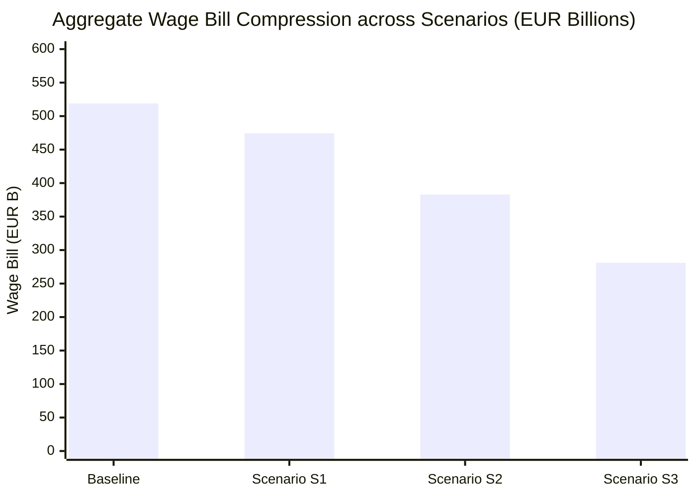
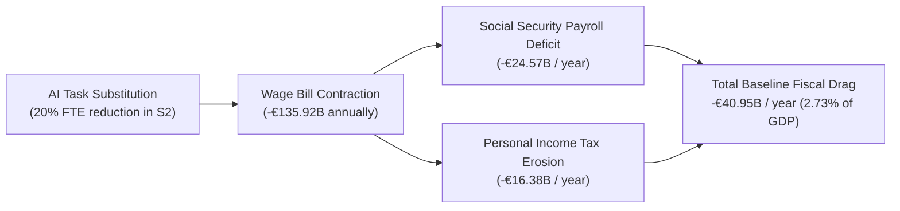

# Chapter 2 · The AI Shock in Spain: Occupational Exposure, Wage-Bill Scenarios (S1–S3), and Fiscal Drag

---

## 1. Mapping AI Exposure into Spain’s Labor Taxonomy (CNO-11 & EPA)

To establish the empirical magnitude of technological displacement, we crosswalk Spain’s *Clasificación Nacional de Ocupaciones 2011* (CNO-11 [INE (CNO-11)]) to international artificial intelligence task-exposure indexes [@felten-2021-aioe; @webb-2020-ai; @eloundou-2024-gpts]. Microdata from the INE *Encuesta de Población Activa* (EPA [INE (EPA)]) covering Spain’s 21.51 million full-time equivalent (FTE) workers are mapped at the two-digit and three-digit occupational level.

Unlike historical capital-embodied automation, which displayed a U-shaped polarization profile displacing routine middle-skill manual labor while leaving cognitive tasks intact [@acemoglu-restrepo-2019], generative AI exhibits an inverted task-substitution profile that concentrates exposure directly in non-routine analytical, administrative, linguistic, and professional roles [@cazzaniga-imf-2024; @korinek-suh-2024]:

| CNO-11 Major Group | Occupational Description | Baseline FTE Employment | AI Exposure Index (0–1) | Primary Automatable Tasks |
|:---:|---|:---:|:---:|---|
| **Group 4** | Clerical & Administrative Support Personnel | 2,420,000 | **0.88** | Data verification, customer billing, basic compliance, standard correspondence, transaction booking. |
| **Group 2** | Scientific & Intellectual Professionals | 4,110,000 | **0.74** | Legal drafting, financial analysis, software testing, medical reporting, translation, actuarial modeling. |
| **Group 3** | Technicians & Support Professionals | 2,650,000 | **0.68** | IT systems administration, accounting assistance, commercial sales coordination, graphic rendering. |
| **Group 5** | Service Workers & Retail Sales Personnel | 4,680,000 | **0.61** | E-commerce order fulfillment, customer inquiry routing, algorithmic scheduling, telemarketing. |
| **Group 1** | Directors & Corporate Managers | 1,050,000 | **0.42** | Operational coordination, strategic planning, resource allocation (partially shielded by leadership tasks). |
| **Group 7** | Craft & Related Trades Workers | 2,120,000 | **0.22** | Physical construction, electrical installation, carpentry, mechanical maintenance (high manual dexterity). |
| **Group 8** | Plant & Machine Operators, Assemblers | 1,780,000 | **0.25** | Heavy vehicle operation, precision assembly (already partially automated by classic robotics). |
| **Group 9** | Elementary Occupations | 2,700,000 | **0.14** | Personal cleaning, waste collection, domestic care, agricultural manual labor (high physical contextuality). |

Occupations in Groups 2, 3, and 4 represent **42.7% of total formal employment** in Spain and account for over **54.2% of aggregate personal income tax (IRPF) withholding receipts**. Because these cohorts constitute the fiscal backbone of the Spanish middle class, cognitive automation induces disproportionate fiscal drag.

---

## 2. Counterfactual Labor Market Distributions across Scenarios S1, S2, and S3

Following Decision `D-006`, we model labor displacement across three macroeconomic scenarios calibrated against Spain’s national accounts (*Contabilidad Nacional Anual de España*, CNE) and Social Security affiliation records (*Muestra Continua de Vidas Laborales*, MCVL [TGSS (MCVL)]):

### Quantitative Metrics across Scenarios

| Macroeconomic & Labor Indicator | **Baseline (2024)** | **Scenario S1 (Moderate)** | **Scenario S2 (Severe)** | **Scenario S3 (Structural)** |
|---|:---:|:---:|:---:|:---:|
| **Analytical Time Horizon** | Present | 3–5 years | 5–10 years | 8–15 years |
| **Labor Income Share of GDP ($s_L$)** | 52.4% | 49.9% ($\Delta = -2.5$ pp) | 45.4% ($\Delta = -7.0$ pp) | 37.4% ($\Delta = -15.0$ pp) |
| **Total Baseline FTE Employment** | 21,510,000 | 21,510,000 | 21,510,000 | 21,510,000 |
| **Displaced Human FTEs** | 0 | **1,720,800** | **4,302,000** | **7,528,500** |
| **Net Displaced FTE Share** | 0.0% | **8.0%** | **20.0%** | **35.0%** |
| **Pre-Shock Aggregate Wage Bill** | €518.89B | €518.89B | €518.89B | €518.89B |
| **Post-Shock Aggregate Wage Bill** | €518.89B | **€474.32B** | **€382.97B** | **€281.07B** |
| **Contraction in Total Wage Earnings** | €0.00B | -€44.57B ($-8.6\%$) | -€135.92B ($-26.2\%$) | -€237.82B ($-45.8\%$) |

In **Scenario S2**—the central reference benchmark for this study—over 4.30 million full-time equivalent workers experience involuntary displacement or severe hours reductions. Aggregate labor earnings contract by €135.92 billion annually, reflecting not only outright employment losses but also substantial downward wage pressure on surviving workers as displaced professionals compete for non-automatable service roles [@acemoglu-2024-macro-ai].

---

## 3. Quantification of Fiscal Drag on Social Security and IRPF

Because Spain's public revenue structure is heavily weighted toward labor compensation, the contraction of the wage bill precipitates an immediate, automatic erosion of public tax yields:

### Breakdown of Baseline Tax Losses by Revenue Stream

| Fiscal Revenue Component | Baseline Yield (EUR B) | S1 Tax Loss (EUR B) | S2 Tax Loss (EUR B) | S3 Tax Loss (EUR B) |
|---|:---:|:---:|:---:|:---:|
| **Employer Social Security Contributions** (23.6%) | €122.46B | -€5.73B | -€15.97B | -€34.22B |
| **Employee Social Security Contributions** (4.7%) | €24.39B | -€1.14B | -€3.18B | -€6.82B |
| **Unemployment & Vocational Training Levies** (7.05%) | €36.58B | -€1.71B | -€4.77B | -€10.22B |
| **Total Social Security System Revenue Drag** | **€183.43B** | **-€8.82B** | **-€24.57B** | **-€52.65B** |
| **Personal Income Tax (IRPF) Labor Tranches** | €118.20B | -€5.88B | -€16.38B | -€35.10B |
| **Total Annual Baseline Fiscal Drag** | **€301.63B** | **-€14.70B** | **-€40.95B** | **-€87.75B** |
| **Fiscal Drag as a Share of GDP** | 20.1% of GDP | **0.98% of GDP** | **2.73% of GDP** | **5.85% of GDP** |

Under Scenario S2, the automatic reduction in public revenue reaches **€40.95 billion per year** (2.73% of GDP). Under Scenario S3, the loss surges to **€87.75 billion per year** (5.85% of GDP). This demonstrates mathematically that any attempt to finance unconditional basic income through conventional labor income tax surcharges or higher payroll contribution rates is self-defeating: taxing human labor at higher marginal rates during rapid automation accelerates firm incentives to substitute workers with autonomous AI agents [@guerreiro-rebelo-teles-2022-robots].

---

## 4. Interaction with Spain’s Labor Market Institutions

The macroeconomic transmission of AI displacement is shaped by three institutional features of the Spanish labor framework [@boe-ce-1978; @boe-rdl-32-2021-reforma-laboral]:
1. **Dismissal Regulation (*Estatuto de los Trabajadores*):** Statutory severance pay for unfair dismissal (33 days per year worked, capped at 24 monthly payments) creates an initial friction that delays abrupt mass terminations in large enterprises. However, firms navigate this barrier by freezing entry-level hiring, outsourcing cognitive workflows to cloud AI APIs, and utilizing objective collective redundancy procedures (*Despidos Colectivos*, Art. 51 ET) grounded in technological and organizational causes.
2. **Sectoral Collective Bargaining (*Convenios Colectivos*):** Rigid sectoral wage floors prevent downward wage flexibility in formal unionized sectors [@bentolila-2012-dual-spain]. Consequently, when technological productivity expands outside the bargaining unit, labor adjustment occurs primarily along the **employment margin** rather than the wage margin, converting displacement into involuntary unemployment.
3. **The Contributory Cliff in Unemployment Benefits:** Contributory unemployment assistance (*prestación contributiva por desempleo*, managed by SEPE) provides 70% of the regulatory base for the first 180 days and 60% thereafter, terminating after a statutory ceiling of 24 months [@boe-trlgss-2015]. Displaced workers who exhaust contributory entitlement fall directly into the means-tested *Subsidio por Desempleo* (€480/month) or the non-take-up abyss of the IMV. 

By delivering an unconditional, non-withdrawable monthly transfer, Universal Basic Rent prevents displaced workers from entering destitution, preserves their reservation wage against exploitative hyper-flexible gig contracts, and finances the search frictions inherent in technological re-skilling [@bartik-2024-openresearch].
