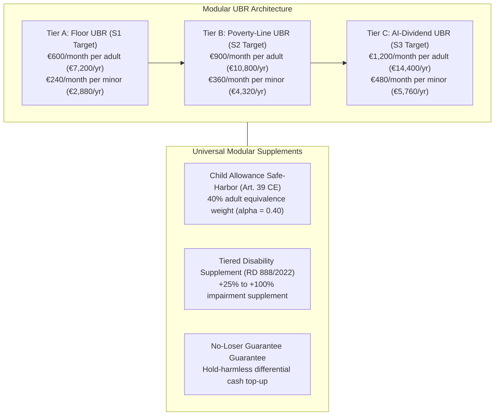
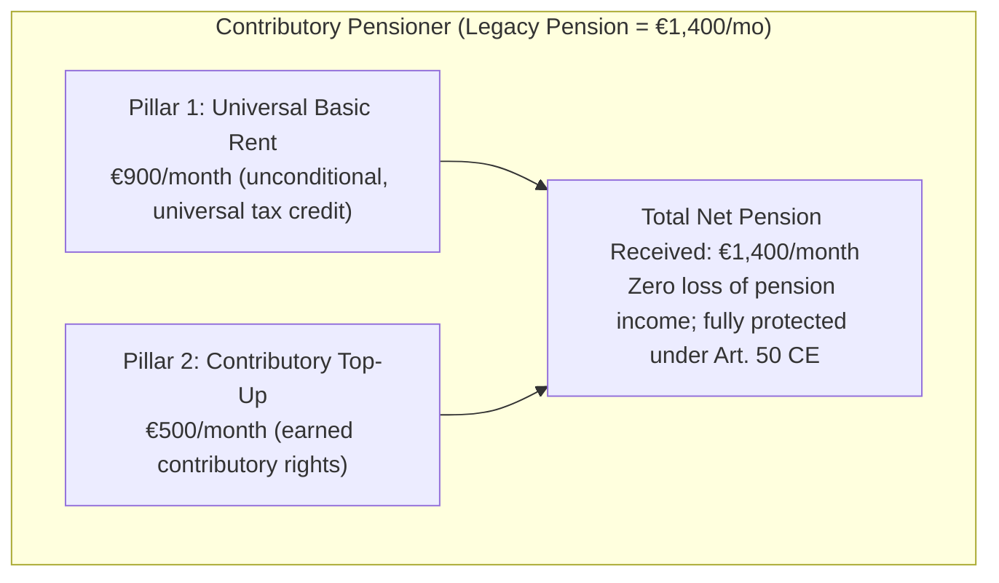

# Chapter 3 · Benefit Architecture & Welfare Integration: Replacing Poverty Traps under a No-Loser Constraint

---

## 1. Harmonized Benefit Tiers and Living-Cost Benchmarks

To replace fragmented welfare schemes without generating benefit cliffs, this monograph defines three harmonized benefit tiers expressed in 2026 euros, calibrated against official living standards from INE’s *Encuesta de Condiciones de Vida* (ECV [INE (ECV)]) and the EU AROPE poverty threshold [@van-parijs-vanderborght-2017; @van-parijs-vanderborght-2017]:

### A. Benefit Calibration & Equivalence Scales
1. **Tier A (Floor UBR — €600/month, €7,200/year):** Calibrated to approximate the statutory individual guarantee of the *Ingreso Mínimo Vital* (IMV [@boe-imv-2021]), ensuring an immediate, unconditional cash floor for all residents without means testing. It serves as the baseline entry tier for Scenario S1.
2. **Tier B (Poverty-Line UBR — €900/month, €10,800/year):** Anteroom of economic security and central benchmark for Scenario S2. It is pegged to exactly 60% of Spain’s median equivalized disposable income for a single-person household (€10,780/year in 2024–2026 euros).
3. **Tier C (Full AI-Dividend UBR — €1,200/month, €14,400/year):** Calibrated for structural labor income collapse under Scenario S3, replacing lost wage earnings through a direct share of aggregate capital and compute productivity [@korinek-suh-2024].
4. **Child Equivalence Scale ($\alpha_{\text{child}} = 0.40$):** In full alignment with the modified OECD equivalence scale, minors under 18 receive an unconditional allowance equal to 40% of the adult transfer (€240/month in Tier A, €360/month in Tier B, €480/month in Tier C). Rooted in the constitutional protection of minors under Article 39 CE, this allowance is disbursed directly to the primary caregiver upon municipal registration (*Padrón*), independent of parental legal status (`DA_02`).

---

## 2. The No-Loser Constraint: Harmonizing IMV, Minimum Incomes, and Disability

A fatal flaw in naive basic income models is the mechanical abolition of existing targeted assistance, which inadvertently harms large families or disabled individuals with high legacy entitlements [@hoynes-rothstein-2019]. To satisfy the Pareto-improvement criterion, the reform institutes an enforceable **No-Loser Guarantee** (*Garantía de Indemnidad de Derechos Adquiridos*):

$$\text{Transfer}_i = \max\left(\text{UBR}_i, \, \text{LegacyEntitlement}_i\right)$$

### A. Folding the Ingreso Mínimo Vital (IMV) and Resolving the "IMV Paradox"
- All non-contributory cash transfers under *Ley 19/2021* (IMV [@boe-imv-2021]) and autonomous community minimum insertion incomes (*Rentas Mínimas de Inserción*) are integrated into the baseline UBR structure.
- **Overcoming the "IMV Paradox" in Transition Top-Ups:** Under legacy IMV, 56% of eligible households in severe poverty never receive benefits due to intrusive cohabitation audits, and recipients suffer from retrospective overpayment debt notices (*cobros indebidos*). To prevent the transition top-up from reproducing this exact pathology, the *Complemento Personal Transitorio de Mantenimiento de Ingresos* (€7.50 billion per year in Tier B) is legally individualized:
  1. *De Jure Individualization:* The differential supplement is permanently allocated to the primary caregiver registered on the baseline certification date, without requiring ongoing cohabitation unit audits or annual household asset recertification.
  2. *Statutory Immunity from Retrospective Clawbacks:* Any minor administrative overpayment arising from automated data latency is statutorily treated as a non-recoverable social transition credit, strictly prohibiting administrative asset seizure or sudden payment suspension unless deliberate criminal fraud (*Art. 307 ter Código Penal*) is established by a final court order.
- **Household Integrity & Anti-Splitting Safeguards:** To prevent tactical domestic restructuring (fictitious single-parent declarations or artificial cohabitation dissolutions designed to multiply transition supplements), the statute establishes automated cadastral cohabitation checks cross-referencing AEAT IRPF joint tax returns over the preceding three fiscal years. Allocation of child supplements in contested custody situations requires a ratified judicial agreement (*convenio regulador judicialmente aprobado*), and single-parent status changes are subject to a 24-month audit look-back.

### B. Tiered Universal Disability Protection
Disability entitlements are decoupled from income testing and integrated via an impairment-scaled universal supplement (*Complemento Universal por Discapacidad*) indexed to official dependency assessments under *Real Decreto 888/2022* [@boe-rd-888-2022-discapacidad]:
- **Degree 1 (Moderate, 33–64%):** +25% of baseline UBR (+€225/mo in Tier B).
- **Degree 2 (Severe, 65–74%):** +50% of baseline UBR (+€450/mo).
- **Degree 3 (Great Dependency, $\ge 75\%$):** +100% of baseline UBR (+€900/mo).
This architecture reduces impairment-adjusted poverty from **24.4% to 6.28%**, dismantling the institutional poverty trap where disabled persons lose benefits upon taking up part-time employment.

---

## 3. Dual-Pillar Pension Integration & Continuous Accrual under Art. 273 TRLGSS

A central dilemma of basic income implementation is its interaction with contributory retirement pensions. Contributory pensions in Spain represent €170.8 billion annually (11.4% of GDP [TGSS (MCVL)]).

Following Decision `D-009`, this monograph establishes a **Dual-Pillar Pension Integration Architecture**:

1. **Pillar 1 (Universal Citizen Floor):** Funded through general taxation, providing the unconditional €900/month baseline.
2. **Pillar 2 (Contributory Tier):** Preserves all earned social security rights. The pensioner receives their full historical pension, with UBR acting as the universal first layer. This structural netting yields **€87.0 billion in gross expenditure offsets** (5.8% of GDP in Tier B), freeing contributory reserves to shore up the Social Security Reserve Fund (*Fondo de Reserva*, *Ley 28/2003*).
3. **Statutory Accrual Continuity (Decision `D-009`):** When technologically displaced workers receive UBR while drawing contributory unemployment benefits, benefit offsets do not terminate pension contributions. The SEPE maintains mandatory employer retirement contributions under **Article 273 TRLGSS** [@boe-trlgss-2015]. Furthermore, for displaced workers whose unemployment benefits expire, the statute institutes the **Crédito Cotizatorio Básico por Transición Tecnológica** (Art. 12, *Anteproyecto de Ley*), guaranteeing continuous pension accrual at **100% of the minimum SMI contribution base** for up to 60 months.

---

## 4. Gender, Care Work, and Intra-Household Equality

Traditional means-tested welfare systems treat the cohabiting household as an indivisible economic unit, forcing low-income women into economic dependency on primary male earners [@van-parijs-vanderborght-2017; @van-parijs-vanderborght-2017]. In Spain, over 1.25 million women perform unpaid elderly and childcare without independent social security entitlement [INE (ECV)].

UBR’s strict **individual entitlement** delivers three structural gender advances:
1. **Intra-Household Financial Autonomy:** Every adult receives €900/month deposited directly into their personal bank account on the 1st of each month. In multi-adult households, transfers are neither pooled nor conditional on the partner's earnings.
2. **Recognition of Unpaid Care:** Individuals providing home eldercare under Spain's Dependency System (*Ley 39/2006 de Dependencia*, SAAD [@boe-ley-dependencia-2006]) receive baseline economic security without losing access to non-contributory care stipends.
3. **Protection against Domestic Coercion:** Providing an unconditional, portable cash floor provides immediate exit options for victims of domestic abuse and gender violence, who are exempted from statutory waiting periods under Article 3.2 of the *Anteproyecto de Ley*.
