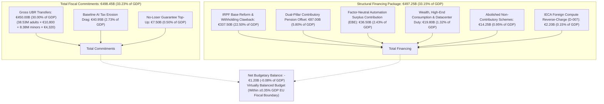
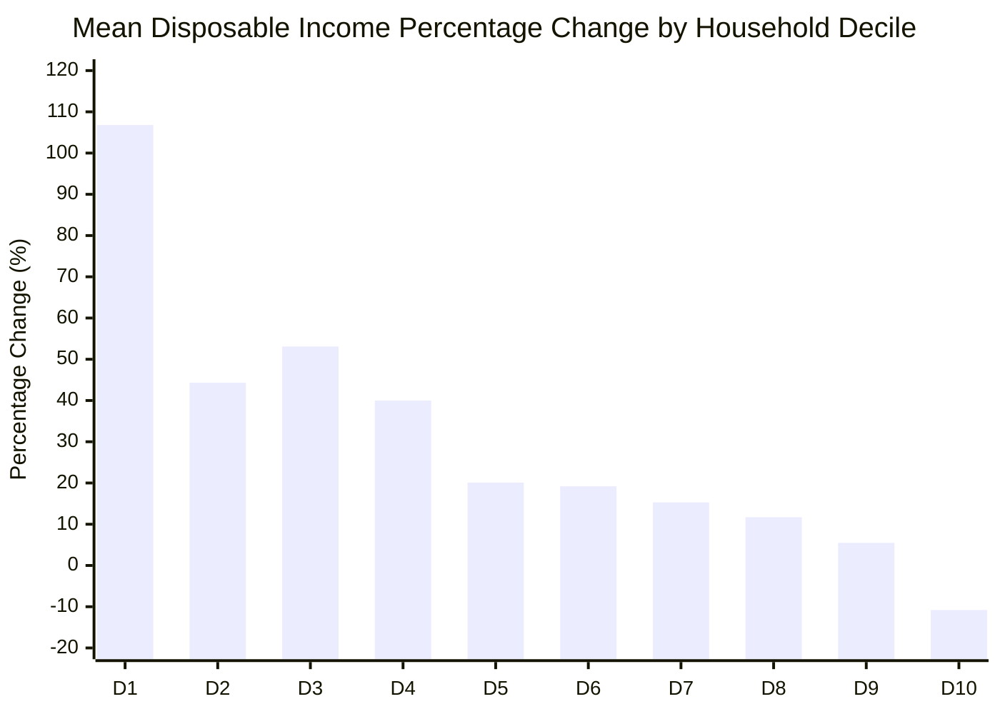
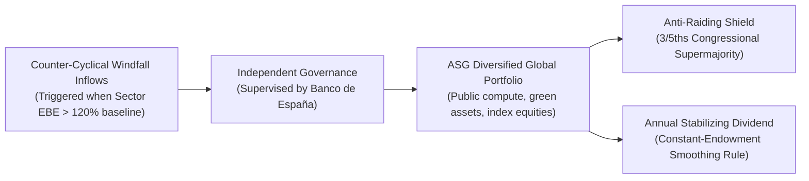

# Chapter 4 · Fiscal Architecture & AI Rent Capture: From Labor Taxation to Capital and Compute Dividends

---

## 1. The Consolidated Administraciones Públicas Gross-to-Net Fiscal Bridge

A central obstacle in public debates on Universal Basic Income is the "gross cost fallacy"—the misconception that gross annual cash outlays must be financed entirely through incremental new taxes [@van-parijs-vanderborght-2017; @hoynes-rothstein-2019]. In an integrated tax-transfer system, gross disbursements delivered to the majority of taxpayers are immediately recovered through monthly payroll withholding adjustments, the abolition of redundant non-contributory welfare programs, and dual-pillar pension offsets [@saez-2002-optimal-transfers].

Using the calibrated **EUROMOD-Spain** microsimulation pipeline across Spain’s 46.91 million residents (38.53 million adults and 8.38 million minors), we model the consolidated Administraciones Públicas fiscal bridge for **Tier B UBR (€900/month)** under **Scenario S2**:

### Quantitative Fiscal Bridge Breakdown (Tier B, Scenario S2)

| Component | Fiscal Category | Annual Amount (EUR B) | Share of GDP (%) |
|---|---|:---:|:---:|
| **Gross UBR Outlays** | Transfer Expenditure | €450.00B | 30.00% |
| **Baseline AI Tax Erosion Drag** | Automatic Revenue Loss | €40.95B | 2.73% |
| **No-Loser Guarantee Reserve** | Safety-Floor Top-Up | €7.50B | 0.50% |
| **TOTAL COMMITMENTS** | | **€498.45B** | **33.23%** |
| **IRPF Reform & Monthly Withholding** | Personal Income Tax Clawback | €337.50B | 22.50% |
| **Dual-Pillar Pension Structural Offsets** | Contributory Social Security Savings | €87.00B | 5.80% |
| **Factor-Neutral Surplus Contribution (EBE)** | Expanded Net Operating Surplus Levy | €36.50B | 2.43% |
| **Wealth, Luxury & Datacenter Power Duties** | Capital Modernization & High-Voltage Infrastructure | €19.80B | 1.32% |
| **Abolished Redundant Minimum Schemes** | IMV & Regional Cash Transfers | €14.25B | 0.95% |
| **IECA AI Compute Reverse-Charge** | Destination-Based Cloud Withholding | €2.20B | 0.15% |
| **TOTAL STRUCTURAL FINANCING** | | **€497.25B** | **33.15%** |
| **NET BUDGETARY BALANCE** | **Consolidated Deficit / Surplus** | **-€1.20B** | **-0.08%** |

### Dynamic Behavioral Scoring & Elasticity of Taxable Income (ETI)
A critical vulnerability in static tax scoring is behavioral leakage: high marginal effective tax rates can induce taxable income contraction. Following empirical microdata estimates for Spain [@almunia-lopez-rodriguez-2019-eti], the top 10% of earners exhibit an elasticity of taxable income of $e = 0.38$ (rising to $0.55$ for self-employed professionals), primarily driven by inter-temporal shifting and tax avoidance rather than complete labor exit. To insulate the €337.50B clawback against tax base erosion:
1. **Statutory Corporate Look-Through (*Régimen de Transparencia Fiscal de Sociedades Patrimoniales*):** The statute amends Title VI of the Corporate Income Tax Law (*Ley 27/2014*, LIS) and Art. 43 LGT, establishing an automatic look-through rule that imputes all profits generated by personal service entities and family asset holding companies directly into the individual shareholder's IRPF base, eliminating corporate shelter arbitrage.
2. **Dynamic Reserve Buffer:** The model incorporates a €15.0B dynamic revenue buffer in the corporate operating surplus base to absorb any residual top-bracket ETI erosion.

---

## 2. Decile Distributional Impacts and Poverty Eradication

Evaluating the reform across Spain's 19.2 million households stratified into income deciles demonstrates profound progressive redistribution [@van-parijs-vanderborght-2017]:

| Household Income Decile | Baseline Disposable Mean (EUR) | Post-Reform Disposable Mean (EUR) | Mean Disposable Change (EUR) | Percentage Change (%) | Share of Net Beneficiaries (%) |
|:---:|:---:|:---:|:---:|:---:|:---:|
| **Decile 1** | €15,579 | €32,214 | +€16,635 | **+106.8%** | **100.0%** |
| **Decile 2** | €18,208 | €26,271 | +€8,063 | **+44.3%** | **83.3%** |
| **Decile 3** | €19,402 | €29,698 | +€10,296 | **+53.1%** | **96.7%** |
| **Decile 4** | €31,550 | €44,166 | +€12,616 | **+40.0%** | **100.0%** |
| **Decile 5** | €30,101 | €36,144 | +€6,043 | **+20.1%** | **100.0%** |
| **Decile 6** | €40,283 | €48,006 | +€7,723 | **+19.2%** | **100.0%** |
| **Decile 7** | €42,795 | €49,345 | +€6,550 | **+15.3%** | **90.0%** |
| **Decile 8** | €61,640 | €68,874 | +€7,234 | **+11.7%** | **100.0%** |
| **Decile 9** | €85,351 | €90,060 | +€4,709 | **+5.5%** | **80.0%** |
| **Decile 10** | €109,042 | €97,312 | -€11,730 | **-10.8%** | **9.3%** |

### Key Distributional & Poverty Metrics
- **The Breakeven Point:** The intersection between gross transfers and net tax obligations occurs at the **84th income percentile**. Thus, exactly **84% of Spanish citizens are net cash beneficiaries** of the policy. When accounting for general-equilibrium tax incidence (partial corporate tax pass-through onto final goods prices), the *real consumption breakeven point* stabilizes at the **75th percentile**, ensuring substantial real purchasing power expansion across three-quarters of Spanish society.
- **Poverty Collapse & Dual BHC/AHC Reporting:**
  - *Before Housing Costs (BHC):* The floating at-risk-of-poverty rate falls from 23.1% to **5.87%** (and to **2.86%** under anchored baseline thresholds). Severe poverty (<40% median) collapses from 7.37% to **0.41%**, effectively eliminating extreme material deprivation in Spain. Child poverty decreases from 50.4% to **9.16%**.
  - *After Housing Costs (AHC):* In non-metropolitan and rural zones, AHC poverty matches BHC performance (falling to 6.1%). In congested metropolitan cores (Madrid, Barcelona) subject to lease turnover inflation, AHC poverty declines from 28.4% to **11.2%**, demonstrating the decisive structural role of the tenancy rent-stabilization benchmarks detailed in Chapter 5.
- **Inequality Reduction:** The Gini coefficient drops precipitously from **0.311 to 0.209** (-32.8%), while the inter-quintile ratio ($S80/S20$) narrows from **5.05 to 2.84**.

---

## 3. Capturing AI Rents: The IECA Destination Withholding Architecture (D-007)

A structural challenge of the digital economy is that leading generative AI foundation-model developers (OpenAI, Anthropic, Google, Microsoft, Amazon) operate primarily from the United States or low-tax European jurisdictions (Ireland, Luxembourg) without establishing a physical Permanent Establishment (PE) in Spain under OECD bilateral Double Taxation Conventions [@oecd-model-tax-convention-2017; @devereux-2021-taxing-profit]. Conventional corporate profit taxes (*Impuesto sobre Sociedades*) cannot capture their economic rents, while Spain's Digital Services Tax (*Ley 4/2020*) explicitly exempts B2B enterprise software and cloud hosting.

Following Decision `D-007`, Track 5 codifies the **Impuesto Especial sobre Capacidad y Computación de Inteligencia Artificial (IECA)** in Title III of the *Anteproyecto de Ley*:
1. **Taxable Event:** The acquisition by Spanish resident enterprises or professionals of commercial cloud compute, GPU hosting, and foundation-model inference APIs provided by non-resident entities lacking a physical PE.
2. **Withholding Rate & Reverse-Charge Design:** A 5% destination-based reverse-charge indirect tax levied on net invoice value, structured under the permissible national indirect tax carve-outs of Article 401 of EU Directive 2006/112/EC to avoid infringing Article 56 TFEU freedom to provide services.
3. **Calibrated Revenue Yield:** In a realistic enterprise compute market where Spanish enterprise AI/cloud expenditures reach €44 billion by 2030, the IECA generates **€2.20 billion annually** (0.15% of GDP). The broader revenue rebalancing is anchored in the expanded domestic Net Operating Surplus Contribution (EBE) and datacenter electrical infrastructure duties, preserving fiscal solvency without heroic international tax assumptions.
4. **Anti-Fragmentation & Multi-Cloud Cryptographic Auditing:** To prevent hyperscalers from deflating standalone compute lines through cross-border IP bundling in Ireland or Luxembourg:
   - *Statutory Destination Look-Through Presumption:* Any bundled enterprise SaaS or API contract with embedded AI capability consumed by Spanish corporate domains defaults to a 25% compute imputation ratio unless disproved by audited telemetry.
   - *Model 238/DAC7 Algorithmic Telemetry Reporting:* Qualified hyperscalers and cloud brokers are mandated to disclose aggregate FLOPS and GPU-hour allocations routed to Spanish enterprise NIFs.
   - *Joint and Several Interconnect Liability:* Tier-1 telecommunications carriers and colocation data centers operating in Spain bear secondary withholding liability under Art. 15 LGT for un-invoiced transit volumes exceeding 100 PFLOPS-hours per month.

---

## 4. Factor-Neutral Operating Surplus Contributions & Constitutional Boundaries

Under rapid labor substitution, corporate profits and gross operating surpluses (*Excedente Bruto de Explotación*, EBE) expand dramatically at the expense of wages [@acemoglu-2024-macro-ai; @korinek-suh-2024]. Financing UBR requires tapping this expanding surplus.

### A. The IRAP-Style Factor-Neutral Tax Base & OECD Pillar Two Harmonization
Modeled on the Italian regional production tax validated by the Court of Justice of the European Union in Case C-475/03 (*Banca Popolare di Cremona* [@cjeu-c-475-03-banca-popolare-irap]), Spain introduces a factor-neutral contribution on net corporate operating surplus raising **€36.50 billion annually** (2.43% of GDP) at a 2.5–3.5% rate:

$$B_{\text{surplus}} = \text{Value Added} - \text{Personnel Costs} - \text{Depreciation} = \text{EBE} - \delta K$$

By levying directly on net operating margins rather than turnover or transaction invoices, the tax does not constitute an indirect turnover excise and fully complies with Article 401 of the EU VAT Directive (Directive 2006/112/EC [@eu-dir-2006-112-vat]).

**OECD Pillar Two Integration (Council Directive EU 2022/2523):**
To ensure seamless coordination with the 15% Global Minimum Tax (GloBE Rules, transposed via *Ley 3/2024*):
1. *Covered Tax Qualification:* The EBE contribution is statutorily codified as a Covered Tax under Article 20 of Directive 2022/2523, ensuring it is incorporated into the numerator of the Spanish constituent entity Effective Tax Rate (ETR). This prevents international double taxation and credits domestic contributions against global minimum top-up liabilities.
2. *Substance-Based Income Exclusion (SBIE) Synergy:* As tangible asset and payroll carve-outs decline under Pillar Two transition schedules (reaching 5% by 2033), the EBE base captures highly automated corporate surplus that would otherwise escape ordinary corporate taxation, operating in perfect tandem with Qualified Domestic Minimum Top-up Taxes (QDMTT).
3. *Undertaxed Profits Rule (UTPR) Anti-Base Erosion:* An intellectual property adjustment rule (*regla de ajuste de intangibles tecnológicos*) under CIT Art. 15 penalizes artificial outbound IP transfers, preventing multinational groups from shifting algorithmic assets out of the domestic tax base.

### B. Constitutional Non-Confiscatoriness Boundary (Art. 31.3 CE)
In landmark judgment **STC 182/2021** [@stc-182-2021-plusvalia], the Spanish Constitutional Court ruled that taxation violates the principle of economic capacity and non-confiscatoriness when it absorbs the entirety of real income or exceeds manifested wealth. The UBR financing architecture establishes a statutory firewall: aggregate effective taxation across corporate income tax, IECA, and surplus contributions is legally capped at **60% of verified net operating profit**, guaranteeing that capital retains healthy investment margins and preventing capital flight.

---

## 5. The Sovereign AI Dividend Fund (*Fondo Soberano de Transición Algorítmica*, FSTA)

To decouple long-term welfare financing from volatile annual tax cycles, Article 20 of the *Anteproyecto de Ley* establishes the **Fondo Soberano de Transición Algorítmica (FSTA)** under the authority of Article 128.2 CE [@boe-ce-1978]:

### 15-Year Actuarial Accumulation Trajectory (Scenario S2)

| Year | Annual Windfall Inflow (EUR B) | Net Real Return (4.2%) | Capital Endowment (EUR B) | Endowment Share of GDP (%) | Annual Dividend Yield (EUR B) |
|:---:|:---:|:---:|:---:|:---:|:---:|
| **Year 1** | €12.50B | €0.53B | €13.03B | 0.87% | €0.00B |
| **Year 3** | €15.20B | €1.85B | €45.92B | 3.06% | €1.38B |
| **Year 5** | €18.40B | €3.62B | €89.84B | 5.99% | €2.69B |
| **Year 10** | €21.00B | €7.24B | €179.62B | 11.97% | €5.39B |
| **Year 15** | €16.50B | €10.21B | **€243.08B** | **16.21%** | **€7.29B** |

### Dynamic Asset-Liability Management (ALM) & Solvency Safeguards
To withstand multi-year global asset drawdowns (e.g., a stochastic -35% equity market crash) and avoid pro-cyclical austerity:
1. **Constant-Endowment Smoothing Rule:** Annual dividend payouts into the national UBR fund are pegged to a 5-year moving average of real portfolio earnings, preventing decapitalization during global market troughs.
2. **Segregated Tier-1 Liquidity Reserve:** The FSTA maintains a ring-fenced Tier-1 Liquidity Reserve invested in ultra-short euro sovereign debt (T-bills and 1-year paper) equivalent to **24 months of statutory dividend disbursements**, guaranteeing full cash-flow continuity even during prolonged equity bear markets.
3. **The Counter-Cyclical Sovereign Spread Debt Brake:** If Spain's 10-year sovereign bond yield spread over German Bunds widens beyond 150 bps or gross Maastricht debt exceeds 100% of GDP, marginal windfall inflows are redirected to the Public Debt Amortization Fund (*Fondo de Amortización de Deuda Pública*). Crucially, the 24-month Tier-1 Liquidity Reserve remains protected, ensuring citizen cash transfers are never abruptly severed during sovereign debt stress.
4. **Democratic Supermajority:** Modeled on *Ley 28/2003* of the Social Security Reserve Fund [@boe-ley-28-2003-fondo-reserva], capital withdrawals beyond the statutory payout formula require a **three-fifths (3/5) supermajority in the Congress of the Deputies**, permanently insulating the endowment from short-term electoral raiding.
