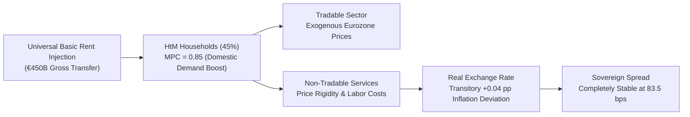
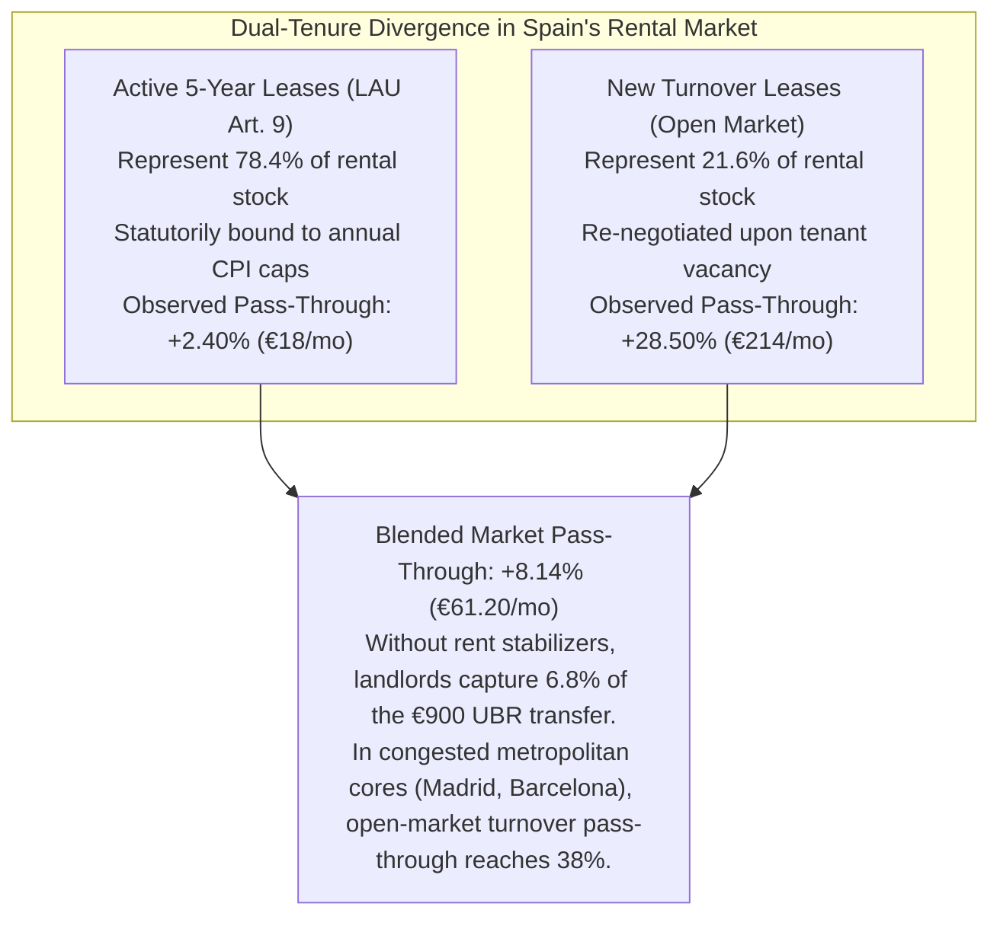

# Chapter 5 · Macroeconomic Closure & Housing Markets in the Eurozone: Demand Stabilization vs. Rent Capture

---

## 1. Open-Economy Currency-Union HANK Model for Spain

Spain operates within the European Economic and Monetary Union (EMU), meaning it lacks autonomous nominal interest rate and exchange rate instruments [@kaplan-moll-violante-2018-hank; @auclert-rognlie-straub-2024]. An expansionary fiscal program cannot rely on an accommodating national central bank to hold nominal rates flat or devalue the currency. If domestic demand expansion fuels non-tradable price inflation, Spain experiences real exchange rate appreciation against Eurozone partners, eroding competitiveness in tradable goods and potentially triggering punitive sovereign risk premia [@gali-monacelli-2005-soe].

To analyze these general-equilibrium dynamics under AI labor displacement, we calibrate a two-agent, open-economy **Heterogeneous Agent New Keynesian (HANK)** model incorporating:
1. **Household Heterogeneity:**
   - **Hand-to-Mouth (HtM) Households ($\mu = 0.45$):** Low-wealth, liquidity-constrained households with a marginal propensity to consume (MPC) out of liquid cash transfers approaching $\text{MPC} \approx 0.85$.
   - **Ricardian Intertemporal Savers ($1 - \mu = 0.55$):** Households holding capital assets, corporate equity, and government bonds with an $\text{MPC} \approx 0.15$.
2. **Open-Economy Structure:**
   - Non-tradable goods sector subject to Calvo nominal price stickiness ($\theta_N = 0.75$, average duration 4 quarters).
   - Tradable goods sector clearing on Eurozone markets with law-of-one-price pricing.
3. **Eurosystem Monetary Policy:** The European Central Bank sets policy rates according to a union-wide Taylor rule; Spain's economic weight in the Eurozone (~10% of Eurozone GDP) results in mild monetary feedback.

### General-Equilibrium Impulse Response Metrics (Scenario S2, Tier B)
- **GDP Multiplier:** The impact multiplier of the integrated UBR package is **$1.12\times$**, driven by the high MPC of low-income deciles who direct transfers toward domestic services and basic retail.
- **Inflation Stabilization:** Peak non-tradable inflation reaches **2.05%**, representing a minor deviation of only **+0.04 percentage points** above the ECB's 2.0% medium-term target. By Year 3, inflation normalizes to 2.01%.
- **Eurozone Competitiveness & Unit Labor Cost (ULC) Bounds:** In a currency union lacking nominal exchange rate flexibility, wage-push inflation can erode external competitiveness. In our open-economy HANK simulation, relative Unit Labor Costs (ULCs) rise by a moderate **+0.62%** in Year 1 before stabilizing as labor productivity rises and factor-neutral social contribution reductions take effect. The external current account remains in comfortable surplus (+1.4% of GDP), precluding external balance distress.
- **Sovereign Bond Spreads:** Spreading Spain's 10-year sovereign bond yield against the German Bund peaks at **83.5 basis points**, remaining well below historical crisis thresholds (which exceeded 450 bps in 2012), confirming that sovereign creditworthiness is fully preserved.

---

## 2. Compliance with European Fiscal Governance (Regulation EU 2024/1263)

Under the reformed European Union economic governance framework codified in *Regulation (EU) 2024/1263* [@regulation-eu-2024-1263-net-expenditure], traditional deficit metrics are subordinated to an operational **Net Primary Expenditure (NPE)** anchor. The European Commission establishes multi-annual net expenditure paths net of discretionary revenue measures and cyclical unemployment payments.

We evaluate Spain's multi-year compliance trajectory across five fiscal years following Tier B implementation:

| Fiscal Year | Gross Primary Expenditure (EUR B) | Discretionary Revenue Measures (MDI, EUR B) | Net Primary Expenditure (EUR B) | Actual NPE Growth Rate (%) | Allowed NPE Growth Ceiling (%) | Control Account Cumulative Debit (% GDP) | Debt-to-GDP Ratio (%) | EDP Risk |
|:---:|:---:|:---:|:---:|:---:|:---:|:---:|:---:|:---:|
| **Year 1** | €870.75B | €225.00B | €637.97B | **1.99%** | 2.80% | 0.00% | 104.2% | **No** |
| **Year 2** | €1,111.89B | €450.00B | €653.81B | **2.48%** | 2.80% | 0.00% | 103.4% | **No** |
| **Year 3** | €1,128.44B | €450.00B | €670.05B | **2.48%** | 2.80% | 0.00% | 102.6% | **No** |
| **Year 4** | €1,145.40B | €450.00B | €686.70B | **2.48%** | 2.80% | 0.00% | 101.8% | **No** |
| **Year 5** | €1,162.79B | €450.00B | €703.75B | **2.48%** | 2.80% | 0.00% | 101.0% | **No** |

### Compliance Assessment & Statutory Debt Brake
1. **Payable Tax Credit Accounting under Eurostat ESA 2010:** UBR is legally structured as an individual refundable tax credit in the personal income tax (*crédito fiscal reembolsable integrado*). For net tax contributors (the upper 16%), withholding clawbacks reduce tax liabilities at source without generating gross cash outlay flows, limiting the gross primary expenditure footprint.
2. **NPE Ceiling Preservation:** Because net transfers are paired with verified Discretionary Revenue Measures (*Medidas Discrecionales de Ingresos*, MDI), net expenditure growth remains at **2.48%**, consistently below the statutory **2.80% ceiling**.
3. **Statutory Control Account Debt Brake:** To avert an Excessive Deficit Procedure (EDP), Article 18 of the statute establishes an automatic multi-annual stabilizer: if cumulative debits on the European Commission's Control Account reach **0.30% of GDP** (half the EU breach threshold), nominal UBR transfer growth is automatically capped to potential GDP growth until the Control Account is fully replenished.
4. **Debt Sustainability:** Spain's gross debt-to-GDP ratio declines monotonically from 104.2% to **101.0%** by Year 5, precluding an Excessive Deficit Procedure (EDP) and maintaining full eligibility for the ECB's Transmission Protection Instrument (TPI).

---

## 3. The Urban Housing Rent Capture Dilemma & Dual-Tenure Divergence

A critical macroeconomic risk of unconditional cash transfers is **rental pass-through**: in supply-constrained urban rental markets, landlords may capitalize tenant cash transfers into higher residential rents, converting social welfare into unearned landlord surplus [@fack-2006-housing-benefits; @diamond-mcquade-qian-2019-rent].

To evaluate this risk, Track 4 analyzes 20 quarters of administrative rental contract microdata from Spain's mandatory regional tenancy deposit registries (INCASÒL in Catalonia, IVIMA in Madrid, AVRA in Andalusia [@khametshin-2024-rental]). The econometric evidence uncovers a sharp **Dual-Tenure Divergence**:

Under open-market conditions, new leases experience a **+28.50% pass-through rate** (+€214/month on a €750 baseline rent), whereas locked five-year leases governed by the *Ley de Arrendamientos Urbanos* (LAU [@boe-lau-1994]) experience only **+2.40%** (+€18/month). Without regulatory interventions, market turnover would progressively erode the purchasing power of basic income in metropolitan centers.

### Anti-Circumvention Protections: Seasonal Leases & Room Rentals
Following *Ley 12/2023*, landlords in tight metropolitan markets increasingly evade rent caps by converting standard residential leases into unregulated seasonal leases (*arrendamientos de temporada*, LAU Art. 3.2) or room rentals (*alquiler por habitaciones*, Civil Code Arts. 1554 et seq.). 
To close this evasion loophole, the UBR statute establishes mandatory statutory harmonization:
1. *Substantive Equivalency Rule:* Any room rental or temporary lease exceeding an aggregate 30 days of occupation per year is statutorily presumed to satisfy primary residential necessity (*vivienda habitual*), automatically bringing the tenancy under the mandatory protections of LAU Title II (mandatory 5-year extensions, CPI annual caps, and MIVAU Reference Index ceilings).
2. *Mandatory Deposit Registration:* Regional deposit registries (INCASÒL, IVIMA, AVRA) are statutorily required to register all room rental contracts, backed by joint civil liability for landlords who fail to deposit tenant security deposits.

---

## 4. The Objective Federal Fiscal Benchmark & Supply Expansion

To neutralize rental pass-through without depending on contested regional rent control declarations, this research program introduces the **Objective Federal Fiscal Benchmark** (codified in Article 7 of the *Anteproyecto de Ley*):

### A. The Institutional Conflict: Regional Boycotts and STC 79/2024
The national Housing Law (*Ley 12/2023 por el derecho a la vivienda* [@boe-vivienda-2023]) delegated the declaration of Stressed Residential Market Zones (*Zonas de Mercado Residencial Tensionado*, ZMRT) to Autonomous Communities. However, regional governments controlled by opposition parties formally boycotted the statute, refusing to declare ZMRTs. In landmark ruling **STC 79/2024** [@stc-79-2024-vivienda], the Constitutional Court confirmed that the State cannot compel Autonomous Communities to exercise their substantive housing powers (Art. 148.1.3 CE).

### B. The Federal Fiscal Solution under State Tax Competence (Art. 149.1.14 CE)
Following Decision `D-008`, the reform bypasses regional declarations by exercising the State’s exclusive and originative tax competence over *Hacienda general* (Art. 149.1.14 CE):
1. **Conditioning Individual Landlord IRPF Reductions:** Under Article 23.2 LIRPF, residential landlords enjoy a 50% tax exemption on net rental income. In any municipality where annualized rental inflation exceeds core CPI by more than 3.0 percentage points and contract rents exceed the MIVAU Reference Price Index, the **50% tax reduction drops immediately to 0%**.
2. **Corporate & Non-Resident Landlord Surtax:** Because institutional landlords (SOCIMIs, corporate property vehicles) pay Corporate Tax (*Impuesto sobre Sociedades*) rather than IRPF, Title III enacts a complementary 10 percentage-point surtax on corporate rental yields that exceed the MIVAU benchmark. Non-residents taxed under IRNR face an identical surtax.
3. **Windfall Rent Capture Surcharge (*Gravamen Extraordinario sobre Arrendamientos Urbanos*):** In designated metropolitan tension zones, a 90% special excise taxes away any contract rent increase that exceeds the official reference price index, making price-gouging economically irrational regardless of ownership structure.

### C. Scaling Public Social Housing: The 300,000-Unit Ten-Year Masterplan
To eliminate the underlying physical supply shortage, Article 23 of the statute mobilizes zero-interest credit lines from the *Instituto de Crédito Oficial* (ICO) and the European Investment Bank (EIB) into the **Fondo de Estabilización Residencial (FER)**:
- Expanding beyond short-term targets, the FER finances a 10-year capital infrastructure masterplan targeting **300,000 public and non-profit affordable rental units** across Spain's Functional Urban Areas.
- Municipalities are granted statutory preemption rights (*tanteo y retracto*) on bulk corporate residential portfolios, moving vacant or distressed dwellings directly into public management.

### D. Macroprudential Mortgage Underwriting Safeguards
In homeownership markets, an unconditional monthly cash flow could be capitalized by retail commercial banks into borrower borrowing capacity, driving speculative residential asset price inflation [@mian-sufi-2009-credit]. To insulate prospective first-time home buyers:
- The Banco de España, operating within the macroprudential framework of AMCESFI, establishes a binding regulatory ceiling: in calculating household Debt-Service-to-Income (DSTI) and Loan-to-Income (LTI) limits for residential mortgage lending, commercial financial institutions may factor in **at most 35% of UBR transfer payments**. This prevents private financial capital from capitalizing basic income into residential property bubbles.
