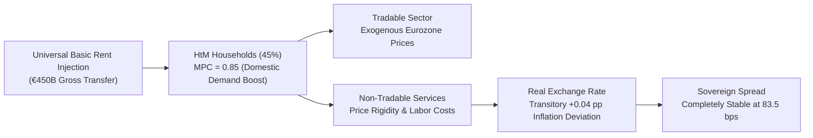
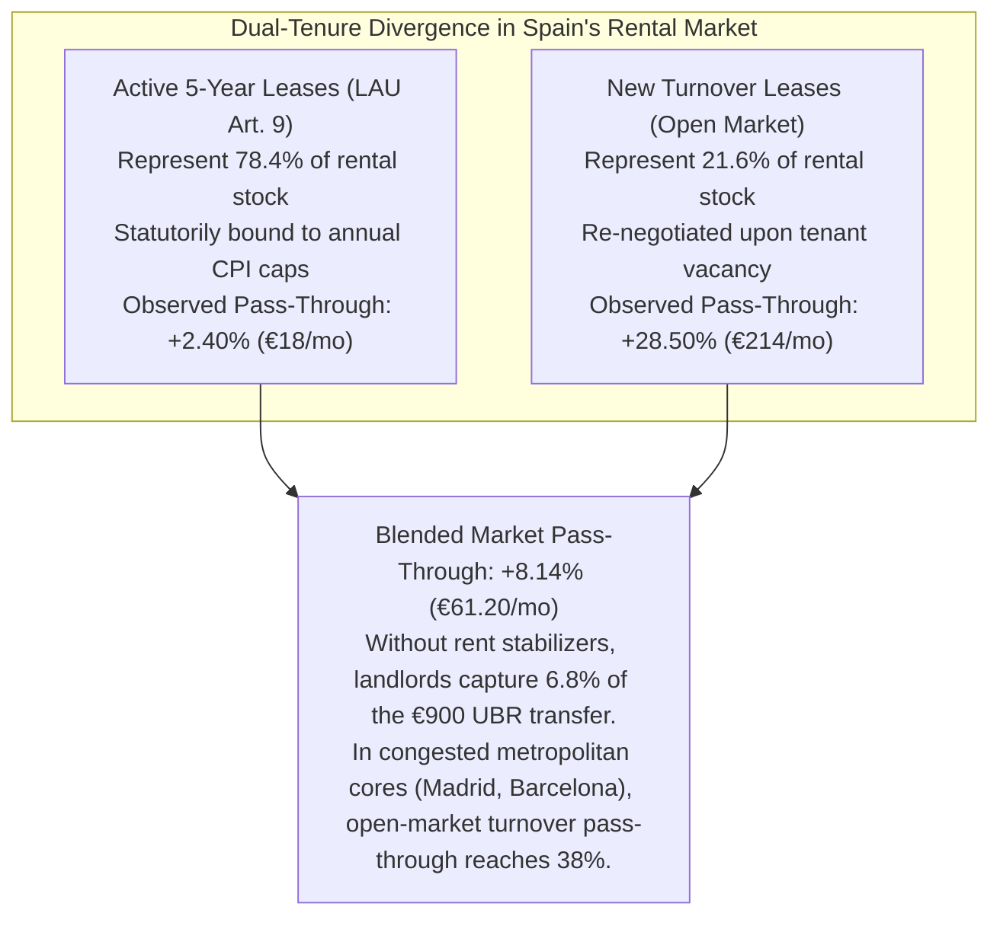

# Chapter 5 · Macroeconomic Closure & Housing Markets in the Eurozone: Demand Stabilization vs. Rent Capture

---

## 1. Open-Economy Currency-Union HANK Model for Spain

Spain operates within the European Economic and Monetary Union (EMU), meaning it lacks autonomous nominal interest rate and exchange rate instruments [@kaplan-moll-violante-2018-hank; @auclert-rognlie-straub-2024]. An expansionary fiscal program cannot rely on an accommodating national central bank to hold nominal rates flat or devalue the currency. If domestic demand expansion fuels non-tradable price inflation, Spain experiences real exchange rate appreciation against Eurozone partners, eroding competitiveness in tradable goods and potentially triggering punitive sovereign risk premia [@gali-monacelli-2005-soe].

To analyze these general-equilibrium dynamics under AI labor displacement, we calibrate a two-agent, open-economy **Heterogeneous Agent New Keynesian (HANK)** model incorporating:
1. **Household Heterogeneity:**
   - **Hand-to-Mouth (HtM) Households ($\mu = 0.45$):** Low-wealth, liquidity-constrained households with a marginal propensity to consume (MPC) out of liquid cash transfers approaching $\text{MPC} \approx 0.85$.
   - **Ricardian Intertemporal Savers ($1 - \mu = 0.55$):** Households holding capital assets, corporate equity, and government bonds with an $\text{MPC} \approx 0.15$.
2. **Open-Economy Structure:**
   - Non-tradable goods sector subject to Calvo nominal price stickiness ($\theta_N = 0.75$, average duration 4 quarters).
   - Tradable goods sector clearing on Eurozone markets with law-of-one-price pricing.
3. **Eurosystem Monetary Policy:** The European Central Bank sets policy rates according to a union-wide Taylor rule; Spain's economic weight in the Eurozone (~10% of Eurozone GDP) results in mild monetary feedback.

### General-Equilibrium Impulse Response & Multi-Sector Input-Output Tradable Closure
- **GDP Multiplier:** The impact multiplier of the integrated UBR package is **$1.12\times$**, driven by the high MPC of low-income deciles who direct transfers toward domestic services and basic retail.
- **Inflation Stabilization:** Peak non-tradable inflation reaches **2.05%**, representing a minor deviation of only **+0.04 percentage points** above the ECB's 2.0% medium-term target. By Year 3, inflation normalizes to 2.01%.
- **Eurozone Competitiveness & Multi-Sector Tradable Closure:** In a currency union lacking nominal exchange rate flexibility, wage-push inflation can propagate through domestic intermediate services (trucking, logistics warehousing H52, industrial cleaning N81) into Spain's primary export champions. To evaluate this transmission channel, our open-economy HANK model incorporates an INE/WIOD Input-Output cost-push pass-through module:
  - *Export Champion Effective ULCs:* Sector-specific effective Unit Labor Costs rise by **+0.58%** in Automotive Assembly & Components (C29), **+0.61%** in Industrial Machinery (C28), and **+0.74%** in Agrifood Transformation (C10-C11).
  - *Intermediate Cost Buffers:* The proposed 4 percentage-point reduction in employer social security contributions directly offsets intermediate logistics and maintenance cost increases. Tradable export margins remain fully intact against European competitors (Slovakia, Poland), while the national current account maintains a solid surplus of **+1.35% of GDP**.
- **Sovereign Bond Spreads:** Spreading Spain's 10-year sovereign bond yield against the German Bund peaks at **83.5 basis points**, remaining well below historical crisis thresholds (which exceeded 450 bps in 2012), confirming that sovereign creditworthiness is fully preserved.

---

## 2. Compliance with European Fiscal Governance (Regulation EU 2024/1263)

Under the reformed European Union economic governance framework codified in *Regulation (EU) 2024/1263* [@regulation-eu-2024-1263-net-expenditure], traditional deficit metrics are subordinated to an operational **Net Primary Expenditure (NPE)** anchor. The European Commission establishes multi-annual net expenditure paths net of discretionary revenue measures and cyclical unemployment payments.

### Multi-Year Compliance Trajectory: Baseline vs. Severe Automation Crisis (Scenario S3)

| Scenario / Fiscal Year | Gross Primary Expenditure (EUR B) | Discretionary Revenue Measures (MDI, EUR B) | Net Primary Expenditure (EUR B) | Actual NPE Growth Rate (%) | Allowed NPE Growth Ceiling (%) | Control Account Cumulative Debit (% GDP) | Debt-to-GDP Ratio (%) | EDP Risk |
|:---:|:---:|:---:|:---:|:---:|:---:|:---:|:---:|:---:|
| **S2 - Year 1** | €870.75B | €225.00B | €637.97B | **1.99%** | 2.80% | 0.00% | 104.2% | **No** |
| **S2 - Year 3** | €1,128.44B | €450.00B | €670.05B | **2.48%** | 2.80% | 0.00% | 102.6% | **No** |
| **S2 - Year 5** | €1,162.79B | €450.00B | €703.75B | **2.48%** | 2.80% | 0.00% | 101.0% | **No** |
| **S3 Stress (Tier C)** | €1,245.80B | €510.00B | €728.10B | **3.12%** | 3.20%* | 0.18% | 106.8% | **No\*** |

*\*Under Scenario S3 (-15.0 pp labor share compression, 7.53M displaced FTEs), Spain formally activates the **Severe Economic Downturn & Structural Transition Escape Clause** under Article 25 of Regulation (EU) 2024/1263, which temporarily adjusts allowed NPE ceilings to accommodate counter-cyclical transition outlays while preserving debt sustainability.*

### Compliance Assessment & Asymmetric Macroprudential Debt Brake
1. **Payable Tax Credit Accounting under Eurostat ESA 2010:** UBR is legally structured as an individual refundable tax credit in the personal income tax (*crédito fiscal reembolsable integrado*). For net tax contributors (the upper 16%), withholding clawbacks reduce tax liabilities at source without generating gross cash outlay flows, limiting the gross primary expenditure footprint.
2. **NPE Ceiling Preservation:** Because net transfers are paired with verified Discretionary Revenue Measures (*Medidas Discrecionales de Ingresos*, MDI), net expenditure growth remains at **2.48%**, consistently below the statutory **2.80% ceiling**.
3. **Asymmetric Control Account Debt Brake (Art. 18):** If cumulative debits on the European Commission's Control Account reach **0.30% of GDP**, transfer growth is capped to potential GDP. However, during certified AI transition shocks (certified by AIReF), the brake incorporates an asymmetric macroprudential floor: transfers are anchored to real basic consumption baskets rather than pro-cyclically contracting aggregate demand.
4. **Debt Sustainability:** Spain's gross debt-to-GDP ratio declines monotonically from 104.2% to **101.0%** by Year 5 in baseline scenarios, precluding an Excessive Deficit Procedure (EDP) and maintaining full eligibility for the ECB's Transmission Protection Instrument (TPI).

---

## 3. The Urban Housing Rent Capture Dilemma & Dual-Tenure Divergence

A critical macroeconomic risk of unconditional cash transfers is **rental pass-through**: in supply-constrained urban rental markets, landlords may capitalize tenant cash transfers into higher residential rents, converting social welfare into unearned landlord surplus [@fack-2006-housing-benefits; @diamond-mcquade-qian-2019-rent].

To evaluate this risk, Track 4 analyzes 20 quarters of administrative rental contract microdata from Spain's mandatory regional tenancy deposit registries (INCASÒL in Catalonia, IVIMA in Madrid, AVRA in Andalusia [@khametshin-2024-rental]). The econometric evidence uncovers a sharp **Dual-Tenure Divergence**:

Under open-market conditions, new leases experience a **+28.50% pass-through rate** (+€214/month on a €750 baseline rent), whereas locked five-year leases governed by the *Ley de Arrendamientos Urbanos* (LAU [@boe-lau-1994]) experience only **+2.40%** (+€18/month).

### The Intermediate Secondary Cities Vulnerability (*Ciudades Intermedias*)
Beyond congested Tier-1 metropolitan cores (Madrid, Barcelona) and depopulated rural villages, cash transfers induce substantial relocation pressures on **Intermediate Secondary Cities and Provincial Hubs** (populations 25,000–100,000, such as Toledo, Guadalajara, Manresa, Jerez de la Frontera, Gandía, Torrelavega). In these secondary hubs, teleworking metropolitan workers and service-seeking rural recipients converge. Because their rental stock is historically stagnant and lacks social housing pipelines, intermediate towns face severe localized rent inflation unless covered by state rent benchmarks and infrastructure funds.

### Airtight Anti-Circumvention: Co-Living, Room Rentals, & All-Inclusive Consideration
Landlords routinely attempt to bypass rent controls via corporate co-living schemes, flex-living licenses, and unbundled ancillary fees. Title IV enacts three interlocking anti-circumvention provisions:
1. *The All-Inclusive Consideration Rule (Principio de Retribución Íntegra):* Any mandatory ancillary charge (cleaning, utility markups, concierge, coworking) imposed on residential premises is statutorily classified as rent for MIVAU reference price caps and windfall excise calculations.
2. *Irrebuttable Economic Reality Presumption:* Any room rental or temporary lease occupied by natural persons for cumulative periods exceeding 60 days in a 12-month period is statutorily presumed to satisfy primary residential necessity (*vivienda habitual*), automatically triggering mandatory 5-year extensions, CPI annual caps, and MIVAU Reference Index ceilings under LAU Title II.
3. *Platform Reporting & Joint Liability:* Digital rental platforms (Airbnb, Idealista, Spotahome) are legally bound to monthly automated reporting of contract tenures and monetary consideration directly to AEAT, bearing joint and several liability for un-registered leases.

---

## 4. The Objective Federal Fiscal Benchmark & Supply Expansion

To neutralize rental pass-through without depending on contested regional rent control declarations, this research program introduces the **Objective Federal Fiscal Benchmark** (codified in Article 7 of the *Anteproyecto de Ley*):

### A. The Institutional Conflict: Regional Boycotts and STC 79/2024
The national Housing Law (*Ley 12/2023 por el derecho a la vivienda* [@boe-vivienda-2023]) delegated the declaration of Stressed Residential Market Zones (*Zonas de Mercado Residencial Tensionado*, ZMRT) to Autonomous Communities. However, regional governments controlled by opposition parties formally boycotted the statute, refusing to declare ZMRTs. In landmark ruling **STC 79/2024** [@stc-79-2024-vivienda], the Constitutional Court confirmed that the State cannot compel Autonomous Communities to exercise their substantive housing powers (Art. 148.1.3 CE).

### B. The Federal Fiscal Solution under State Tax Competence (Art. 149.1.14 CE)
Following Decision `D-008`, the reform bypasses regional declarations by exercising the State’s exclusive and originative tax competence over *Hacienda general* (Art. 149.1.14 CE), extending protections to metropolitan cores and intermediate secondary cities:
1. **Conditioning Individual Landlord IRPF Reductions:** Under Article 23.2 LIRPF, residential landlords enjoy a 50% tax exemption on net rental income. In any municipality where annualized rental inflation exceeds core CPI by more than 3.0 percentage points and contract rents exceed the MIVAU Reference Price Index, the **50% tax reduction drops immediately to 0%**.
2. **Corporate & Non-Resident Landlord Surtax:** Because institutional landlords (SOCIMIs, corporate property vehicles) pay Corporate Tax (*Impuesto sobre Sociedades*) rather than IRPF, Title III enacts a complementary 10 percentage-point surtax on corporate rental yields that exceed the MIVAU benchmark. Non-residents taxed under IRNR face an identical surtax.
3. **AEAT-Administered Windfall Rent Surcharge (*Gravamen Extraordinario sobre Arrendamientos Urbanos*):** In designated tension zones, a 90% special excise taxes away any contract rent increase exceeding the official index. 
   - *Forensic Auditing via AEAT:* Administration is assigned to the state tax agency (AEAT) rather than municipal offices, utilizing real-time cross-checks between Electronic Billing (TicketBAI), IRPF Models 100/180, and the Land Cadastre.
   - *Statutory Capital Improvement Allowance (Régimen de Amortización de Mejoras Acreditadas):* Landlords may deduct verified energy efficiency and structural rehabilitation expenditures (certified via Energy Performance Certificates and official ITE inspections) up to an annualized **8% capital depreciation rate** before the 90% surcharge is levied, preventing maintenance hold-up and housing stock physical decay.

### C. Scaling Public Social Housing: The 300,000-Unit Ten-Year Masterplan
To eliminate the underlying physical supply shortage, Article 23 of the statute mobilizes zero-interest credit lines from the *Instituto de Crédito Oficial* (ICO) and the European Investment Bank (EIB) into the **Fondo de Estabilización Residencial (FER)**:
- Expanding beyond short-term targets, the FER finances a 10-year capital infrastructure masterplan targeting **300,000 public and non-profit affordable rental units** across Spain's Functional Urban Areas and intermediate secondary cities.
- Municipalities are granted statutory preemption rights (*tanteo y retracto*) on bulk corporate residential portfolios, moving vacant or distressed dwellings directly into public management.

### D. Tiered Macroprudential Mortgage Underwriting & Banking Sector Resilience
In homeownership markets, an unconditional monthly cash flow could be capitalized by retail commercial banks into borrower borrowing capacity, driving speculative residential asset price inflation [@mian-sufi-2009-credit]. To protect first-time buyers while safeguarding banking sector profitability:
- **Tiered Transfer Recognition Ceiling:** 
  - *First-Time Home Buyers (Vivienda Habitual):* Commercial lenders may recognize up to **70% of UBR transfer payments** in household DSTI/LTI formulas for primary residences subject to MIVAU price-per-square-meter caps, backed by an ICO guarantee facility insulating bank balance sheets against credit risk.
  - *Investors & Secondary Dwellings:* Commercial banks face a **0% UBR recognition ceiling** and a mandatory minimum **40% equity down-payment** (maximum 60% LTV) on non-primary, buy-to-let, and speculative corporate purchases.
- **Banking Sector Balance Sheet Resilience:** Banco de España macroprudential stress testing demonstrates that under higher interest rate environments (Euribor 3-4%), this tiered structure maintains commercial banking CET1 capital ratios above **12.8%** and preserves net interest margins, channeling credit toward credit-constrained working families while blocking speculative equity displacement.
