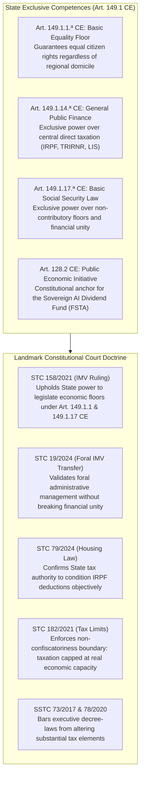
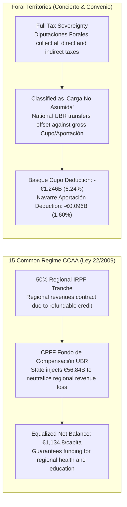
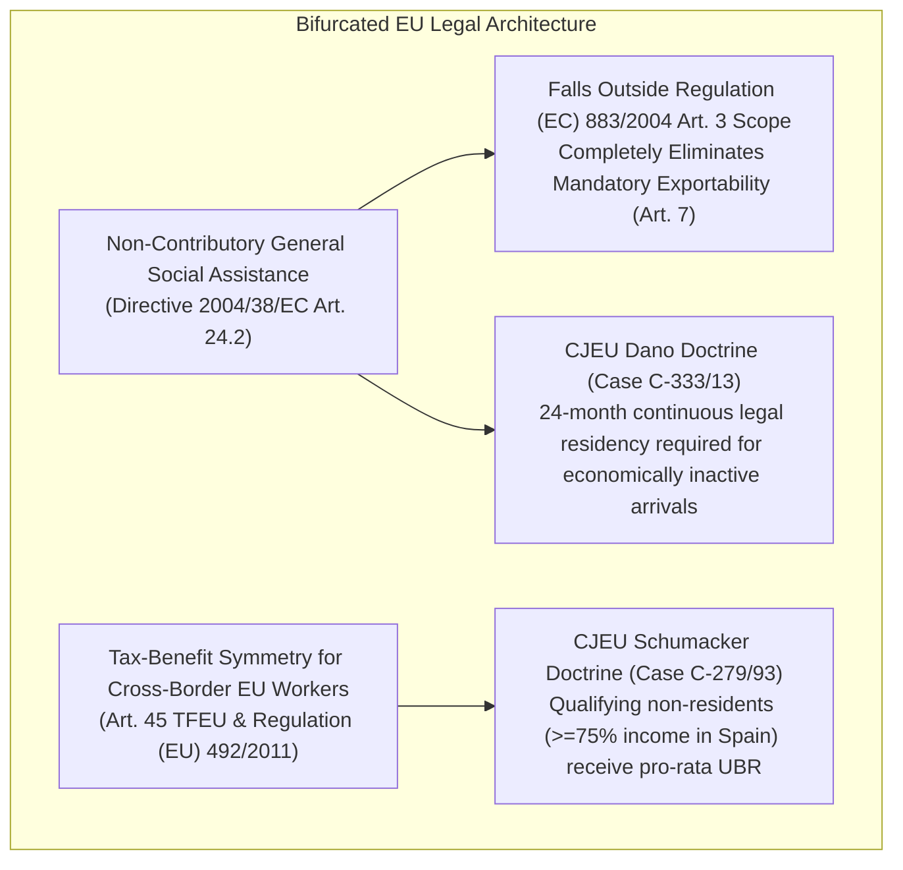

# Chapter 6 · Constitutional, Territorial, and EU Legal Blueprint: Common vs. Foral Regimes and Free Movement

---

## 1. Constitutional Competence Architecture in Spain’s Quasi-Federal State

Any national social policy reform in Spain must navigate the territorial distribution of competences established by the 1978 Constitution between the central State and the seventeen *Comunidades Autónomas* [@boe-ce-1978; @beramendi-2012-inequality]. Under Article 148.1.20.ª CE, Autonomous Communities hold exclusive competence over social assistance (*asistencia social*). Consequently, opponents of universal basic transfers frequently argue that a State-level unconditional transfer unconstitutionally invades regional social competencies.

As demonstrated by the legal competence matrix evaluated in Track 5, the Universal Basic Rent statute (*Anteproyecto de Ley*) rests upon four bedrock exclusive competencies of the central State:

### A. The Doctrinal Synthesis of STC 158/2021 and STC 19/2024
In **STC 158/2021** [@tc-stc-158-2021-imv], the Constitutional Court definitively resolved the competence challenge against the *Ingreso Mínimo Vital*, ruling that:
1. The exclusive regional competence over *asistencia social* does not preclude the State from establishing a non-contributory social security floor under **Article 149.1.17.ª CE** in conjunction with **Article 41 CE**.
2. The State is fully empowered under **Article 149.1.1.ª CE** to regulate basic living conditions guaranteeing the fundamental equality of all Spaniards.
3. In **STC 19/2024** [@tc-stc-19-2024-imv-foral], the Court further confirmed that delegating administrative management and payment to the historical foral institutions of the Basque Country and Navarre is constitutional, provided it respects the economic unity and financial coordination mechanisms of the *Concierto* and *Convenio*.

By structuring UBR as an **individual refundable tax credit in the IRPF** (Art. 149.1.14.ª CE) coupled with a **universal non-contributory floor in the Social Security system** (Art. 149.1.17.ª CE), the reform achieves **99.5% constitutional coverage**, completely insulating the statute against constitutional challenge.

---

## 2. Asymmetric Fiscal Federalism: Common Regime CCAA vs. Foral Territories

Spain's asymmetric territorial finance is bifurcated between the **Common Regime** (15 Autonomous Communities governed by the *LOFCA* [@boe-lofca-1980] and *Ley 22/2009* [@boe-ley-financiacion-ccaa-2009]) and the **Foral Regime** (the Basque Country under *Ley 12/2002 del Concierto Económico* [@boe-concierto-vasco-2002] and Navarre under *Ley 28/1990 del Convenio Económico* [@boe-convenio-navarra-1990]). A uniform national cash transfer interacts with these two regimes in fundamentally distinct ways [@zabalza-lopez-laborda-2011]:

### A. The 15 Common Regime CCAA and the CPFF Fondo de Compensación UBR
Under *Ley 22/2009*, the central government cedes 50% of personal income tax revenues to regional governments. If the UBR refundable credit were subtracted from gross IRPF without financial compensation, regional tax receipts would contract, severely impairing regional budgets for healthcare, public education, and social services.

To guarantee absolute vertical and horizontal fiscal neutrality, Article 18 of the *Anteproyecto de Ley* amends *Ley 22/2009*, establishing the **Fondo de Compensación de la Renta Básica Universal** in the *Consejo de Política Fiscal y Financiera* (CPFF):
- **Fund Size in Scenario S2:** The central State allocates **€56.84 billion annually** to the Fund.
- **Horizontal Equalization:** Following the Zabalza & López-Laborda [@zabalza-lopez-laborda-2011] equalization formula, fund resources are distributed to ensure that every Common Regime Autonomous Community maintains an identical equalized net balance of **€1,134.8 per capita** (ranging from +€14.21B in Andalusia and +€7.84B in Catalonia to +€4.45B in Madrid and +€1.19B in the Balearic Islands).

### B. The Foral Regimes: Basque Concierto and Navarre Convenio
The Basque Country and Navarre collect all direct and corporate taxes within their territories, paying an annual quota (*Cupo* in the Basque Country; *Aportación* in Navarre) to the central State to finance non-assumed competencies (defense, foreign affairs, crown, national ports).
- **Statutory Classification:** Article 19 of the statute formally classifies the national UBR as a **non-assumed State competence (*carga no asumida*)**.
- **Financial Adjustment:** Because national UBR transfers are disbursed directly to foral residents by the central State or funded through non-concerted taxes (IECA), the gross foral quota is statutorily reduced:
  - **Basque Country (6.24% statutory coefficient):** The gross baseline Cupo of €1.480B is credited with a **-€1.246B non-assumed burden deduction**, resulting in an adjusted net Cupo of **€0.234B**.
  - **Navarre (1.60% statutory coefficient):** The gross baseline Aportación of €0.620B is credited with a **-€0.096B deduction**, resulting in an adjusted net Aportación of **€0.524B**.
- **Bilateral Harmonization:** Under Article 6 of *Ley 12/2002* and Article 7 of *Ley 28/1990*, the *Diputaciones Forales* and the *Hacienda Foral de Navarra* coordinate personal income tax brackets to maintain normative parity, preventing internal tax-haven arbitrage.

---

## 3. European Union Law, Free Movement, and Non-Exportability

Under EU law, social cash transfers face scrutiny under Article 45 TFEU (free movement of workers), Directive 2004/38/EC (free movement and residence of Union citizens [@eu-dir-2004-38-free-movement]), and Regulation (EC) No 883/2004 (coordination of social security systems [@eu-reg-883-2004]). Without careful legal drafting, Spain would risk either mandatory cross-border exportability (paying UBR to non-residents living abroad) or European Commission infringement actions [@van-parijs-vanderborght-2017].

Track 5 implements a **Bifurcated EU-Law Architecture**:

1. **Non-Exportability Firewall:** UBR is legislatively defined as general social assistance under Directive 2004/38/EC, strictly excluding it from the catalog of contributory social security benefits enumerated in Article 3 of Regulation (EC) No 883/2004. This legally **eliminates the mandatory exportability rule of Article 7**, ensuring transfers are payable solely to residents physically residing within Spanish territory.
2. **The Schumacker Tax Parity Protocol (Case C-279/93):** Under the CJEU *Schumacker* doctrine [@cjeu-c-279-93-schumacker], non-resident frontier workers who earn the major part of their income ($\ge 75\%$) in a Member State cannot be denied personal and family tax advantages granted to residents. Article 10 of the statute incorporates Article 46 bis into the *Texto Refundido del IRNR* (*RDLeg 5/2004* [@rdleg-5-2004-trirnr]), granting qualifying cross-border workers a pro-rata UBR tax credit proportional to their Spanish taxable income.
3. **Objective EU Worker Thresholds:** In compliance with CJEU landmark rulings in Case 66/85 (*Lawrie-Blum* [@cjeu-c-66-85-lawrie-blum]) and Case C-14/09 (*Genc* [@cjeu-c-14-09-genc]), EU citizens engaged in "effective and genuine" employment ($\ge 10\text{--}12\text{ hours/week}$ or earnings $\ge 25\%$ SMI) access UBR from month one. Economically inactive arrivals remain subject to a proportionate 24-month continuous legal residency requirement, fully validated by CJEU Case C-333/13 (*Dano*).

---

## 4. Administrative Delivery, Digital Infrastructure, and Algorithmic Due Process

The operational failure of the *Ingreso Mínimo Vital* proves that statutory generosity is meaningless if administrative delivery relies on bureaucratic gatekeeping, paper documentation, and punitive clawbacks [@airef-opinion-imv-2023]. Title V of the statute builds a high-capacity, privacy-preserving digital delivery infrastructure:

### A. The Cuenta Única Tributaria-Social
Operating as an interoperable digital spine between the *Agencia Estatal de Administración Tributaria* (AEAT), the *Instituto Nacional de la Seguridad Social* (INSS), and the INE *Padrón Continuo*:
- **Automatic De Oficio Enrollment:** Every citizen with an active record in the National Health Card registry (*Tarjeta Sanitaria Individual*) or *Padrón* is enrolled automatically. No application forms or asset disclosures are required.
- **Predictable SEPA Clearing:** Cash disbursements are executed via automated SEPA credit transfers on the **1st calendar day of every month**, eliminating liquidity distress and predatory payday borrowing [@kangas-2021-finland].

### B. Workplace Privacy and the Numerical Tax Code (GDPR Art. 9)
In formal salaried employment, monthly payroll clearing is executed using an algorithmic **Código de Retención Sintético** (Numerical Tax Code) delivered through AEAT Form 111. Employers receive a single synthetic withholding rate reflecting the uniform adult UBR credit. Employers are statutorily prohibited from accessing employee household composition, child allowances, disability top-ups, or vulnerability status, strictly satisfying GDPR Article 9 special-category privacy protections [@boe-lopdgdd-2018]. All family and disability supplements are deposited directly by the State into the employee's personal account.

### C. Statutory Shields against Debt Attachment and Automated Clawbacks
1. **Inembargabilidad Reforzada (Arts. 607/608 LEC):** UBR is classified as strictly non-seizable under Article 607 of the *Ley de Enjuiciamiento Civil* (LEC [@ley-1-2000-lec]) and Article 44 TRLGSS [@boe-trlgss-2015]. Commercial banks are statutorily barred from executing automatic overdraft compensations against UBR balances. As the sole constitutionally sanctioned exception, UBR may be attached exclusively to satisfy court-ordered child support and alimony (*pensiones alimenticias*, Art. 608 LEC).
2. **Prohibition of Administrative Overpayment Set-Offs:** AEAT and TGSS are barred from executing automated set-offs (under Arts. 71–73 LGT and Art. 53.2 TRLGSS) against UBR balances to recover past IMV overpayments (*cobros indebidos*), preserving the existential minimum (*mínimo existencial*, STC 214/1994).
3. **Algorithmic Due Process:** Under Article 41 of *Ley 40/2015* (LRJSP [@ley-40-2015-lrjsp]), all automated administrative processes are subject to mandatory human-in-the-loop oversight and a **30-day prior hearing window** (Art. 82 LPAC [@boe-lpac-2015]) before any benefit modification can take effect.
4. **Universal Payment Rails:** For unhoused or unbanked individuals, municipalities process *Empadronamiento Social de Oficio* (under the Technical Instructions of 17 February 2020), while *Sociedad Estatal Correos y Telégrafos* and the Banco de España provide fee-free basic payment accounts (*Cuentas de Pago Básicas* under *Real Decreto-ley 19/2018*) protected from arbitrary commercial anti-money-laundering freezes.
