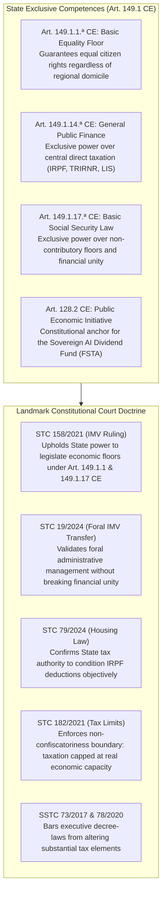
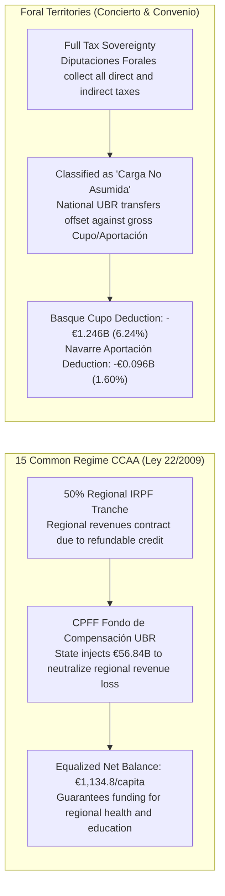

# Chapter 6 · Constitutional, Territorial, and EU Legal Blueprint: Common vs. Foral Regimes and Free Movement

---

## 1. Constitutional Competence Architecture in Spain’s Quasi-Federal State

Any national social policy reform in Spain must navigate the territorial distribution of competences established by the 1978 Constitution between the central State and the seventeen *Comunidades Autónomas* [@boe-ce-1978; @beramendi-2012-inequality]. Under Article 148.1.20.ª CE, Autonomous Communities hold exclusive competence over social assistance (*asistencia social*). Consequently, opponents of universal basic transfers frequently argue that a State-level unconditional transfer unconstitutionally invades regional social competencies.

As demonstrated by the legal competence matrix evaluated in Track 5, the Universal Basic Rent statute (*Anteproyecto de Ley*) rests upon four bedrock exclusive competencies of the central State:

### A. The Doctrinal Synthesis of STC 158/2021 and STC 19/2024
In **STC 158/2021** [@tc-stc-158-2021-imv], the Constitutional Court definitively resolved the competence challenge against the *Ingreso Mínimo Vital*, ruling that:
1. The exclusive regional competence over *asistencia social* does not preclude the State from establishing a non-contributory social security floor under **Article 149.1.17.ª CE** in conjunction with **Article 41 CE**.
2. The State is fully empowered under **Article 149.1.1.ª CE** to regulate basic living conditions guaranteeing the fundamental equality of all Spaniards.
3. In **STC 19/2024** [@tc-stc-19-2024-imv-foral], the Court further confirmed that delegating administrative management and payment to the historical foral institutions of the Basque Country and Navarre is constitutional, provided it respects the economic unity and financial coordination mechanisms of the *Concierto* and *Convenio*.

### Constitutional Anchors and Non-Usurpation Safeguard
To definitively insulate UBR against regional jurisdictional appeals, the statute is grounded in a triad of central constitutional titles:
- **General Economic Direction (Art. 149.1.13 CE) & Public Economic Initiative (Arts. 128.1 and 128.2 CE):** UBR is codified not as a palliative social assistance scheme, but as a structural macroeconomic stabilizer safeguarding aggregate demand and labor productivity during severe technological disruption.
- **Citizen Equality (Art. 149.1.1 CE) & State Finance (Art. 149.1.14 CE):** Guaranteeing identical baseline economic subsistence to all residents through an individual refundable tax credit in the IRPF.
- **Statutory Non-Usurpation Safeguard (*Cláusula de Salvaguarda Competencial Autonómica*):** Article 2 of the statute explicitly recognizes that Autonomous Communities retain exclusive jurisdiction to design, maintain, and supplement regional social assistance (*Rentas Mínimas de Inserción*, Art. 148.1.20 CE) as top-ups above the national citizen dividend floor, strictly respecting STC 158/2021 doctrine.

---

## 2. Asymmetric Fiscal Federalism: Common Regime CCAA vs. Foral Territories

Spain's asymmetric territorial finance is bifurcated between the **Common Regime** (15 Autonomous Communities governed by the *LOFCA* [@boe-lofca-1980] and *Ley 22/2009* [@boe-ley-financiacion-ccaa-2009]) and the **Foral Regime** (the Basque Country under *Ley 12/2002 del Concierto Económico* [@boe-concierto-vasco-2002] and Navarre under *Ley 28/1990 del Convenio Económico* [@boe-convenio-navarra-1990]). A uniform national cash transfer interacts with these two regimes in fundamentally distinct ways [@zabalza-lopez-laborda-2011]:

### A. The 15 Common Regime CCAA and the CPFF Fondo de Compensación UBR
Under *Ley 22/2009*, the central government cedes 50% of personal income tax revenues to regional governments. If the UBR refundable credit were subtracted from gross IRPF without financial compensation, regional tax receipts would contract, severely impairing regional budgets for healthcare, public education, and social services.

To guarantee absolute vertical and horizontal fiscal neutrality, Article 18 of the *Anteproyecto de Ley* amends *Ley 22/2009*, establishing the **Fondo de Compensación de la Renta Básica Universal** in the *Consejo de Política Fiscal y Financiera* (CPFF):
- **Fund Size in Scenario S2:** The central State allocates **€56.84 billion annually** to the Fund.
- **Horizontal Equalization:** Following the Zabalza & López-Laborda [@zabalza-lopez-laborda-2011] equalization formula, fund resources are distributed to ensure that every Common Regime Autonomous Community maintains an identical equalized net balance of **€1,134.8 per capita** (ranging from +€14.21B in Andalusia and +€7.84B in Catalonia to +€4.45B in Madrid and +€1.19B in the Balearic Islands).

### B. The Foral Regimes: Basque Concierto, Navarre Convenio, and Anti-Arbitrage Rules
The Basque Country and Navarre collect all direct and corporate taxes within their territories, paying an annual quota (*Cupo* in the Basque Country; *Aportación* in Navarre) to the central State to finance non-assumed competencies:
- **Statutory Classification:** Article 19 of the statute formally classifies the national UBR as a **non-assumed State competence (*carga no asumida*)**.
- **Financial Adjustment:** Because national UBR transfers are disbursed directly to foral residents by the central State or funded through non-concerted taxes (IECA), the gross foral quota is statutorily reduced:
  - **Basque Country (6.24% statutory coefficient):** The gross baseline Cupo of €1.480B is credited with a **-€1.246B non-assumed burden deduction**, resulting in an adjusted net Cupo of **€0.234B**.
  - **Navarre (1.60% statutory coefficient):** The gross baseline Aportación of €0.620B is credited with a **-€0.096B deduction**, resulting in an adjusted net Aportación of **€0.524B**.
- **The Mandatory Bilateral Tax Harmonization Accord (*Pacto Foral de Armonización*):** To eliminate the risk of domestic tax havens (where high-net-worth individuals transfer tax domicile to Foral provinces to evade national UBR clawback surcharges):
   1. Under the auspices of the *Comisión Mixta del Concierto* (Art. 61 Ley 12/2002) and *Comisión Negociadora del Convenio* (Art. 67 Ley 28/1990), Cupo deductions are statutorily conditioned on the enactment of reciprocal Foral UBR financing surcharges by the *Juntas Generales* and *Parlamento de Navarra*.
   2. *Five-Year Personal and Corporate Anti-Relocation Look-Back:* Modelled on Art. 72.3 LIRPF, taxpayers relocating tax residency from Common Regime CCAA to Foral territories remain subject to Common Regime UBR clawback rates for five tax years. This look-back rule explicitly extends to closely held holding companies (*sociedades patrimoniales*) where >50% of equity or voting rights are held by individuals who relocated within the prior five years.
   3. *Binding Foral Impasse Resolution Protocol:* Under Article 64 of *Ley 12/2002*, if bilateral negotiations reach a deadlock exceeding 60 days, jurisdiction automatically defers to an expedited joint arbitration chamber composed of three state magistrates and three foral representatives, chaired by a Supreme Court nominee, whose precautionary injunctions maintain baseline citizen disbursements without disruption.

---

## 3. European Union Law, Free Movement, and Non-Exportability

Under EU law, social cash transfers face scrutiny under Article 45 TFEU (free movement of workers), Directive 2004/38/EC (free movement and residence of Union citizens [@eu-dir-2004-38-free-movement]), Directive 2003/109/EC (long-term third-country residents), and Regulation (EC) No 883/2004 (coordination of social security systems [@eu-reg-883-2004]).

Track 5 implements an airtight **Tripartite Legal Category Framework**:
1. **Category I: Spanish Nationals & Long-Term Third-Country Residents:** Pursuant to Article 14 CE and Directive 2003/109/EC (*Ley Orgánica 4/2000* Art. 32), third-country nationals holding permanent residence (*Autorización de Residencia de Larga Duración*) enjoy absolute equality of treatment with Spanish citizens, obtaining immediate UBR access from day one.
2. **Category II: EU Cross-Border & Retained Workers:** Pursuant to Article 45 TFEU and Directive 2004/38/EC Art. 7(1)(a), EU citizens engaged in genuine and effective employment (>10 hours/week or earnings $\ge 50\%$ SMI, per CJEU *Genc* [@cjeu-c-14-09-genc] and *Lawrie-Blum* [@cjeu-c-66-85-lawrie-blum]) access UBR from month one. Frontier workers are protected under the *Schumacker* pro-rata tax credit protocol.
3. **Category III: Economically Inactive EU Citizens & Temporary Arrivals:** In full compliance with CJEU landmark rulings (*Dano* C-333/13, *Brey* C-140/12), economically inactive arrivals must establish 24-month continuous lawful residency under Directive 2004/38/EC before non-contributory cash entitlement accrues, backed by individualized proportionality assessments.
4. **Special Non-Contributory Benefit (SNCB) Annex X Inscription:** UBR is formally inscribed into Annex X of Regulation (EC) No 883/2004 pursuant to Article 70, establishing statutory immunity from cross-border exportability and guaranteeing that payments are strictly confined to residents physically residing within Spanish territory.

---

## 4. Administrative Delivery, Digital Infrastructure, and Operational Resilience

Title V of the statute builds a high-capacity, privacy-preserving digital delivery infrastructure:

### A. The Cuenta Única Tributaria-Social and Master Taxpayer Index (MTI)
Operating as an interoperable digital spine between the *Agencia Estatal de Administración Tributaria* (AEAT), the *Instituto Nacional de la Seguridad Social* (INSS), and regional administrations:
- **Master Taxpayer/Citizen Index (MTI/MPI):** Resolves identity discrepancies between NIE regularizations, Social Security numbers (*NAF*), and municipal records via cryptographic hash validation.
- **Inter-Administrative Open-API Protocol (PID):** Mandated under the State Data Intermediation Platform (*Plataforma de Intermediación de Datos*, PID, Ley 40/2015 Art. 155), requiring all 17 Autonomous Communities and Foral Treasuries to deploy standardized Open-API endpoints. Monthly TGSS affiliation changes and AEAT filings emit real-time event-driven settlement tokens.
- **Asynchronous 90-Day Provisional Payment Buffer:** When data mismatches occur across regional health databases and AEAT, payments are never summarily suspended; an automated provisional transfer is executed for up to 90 days under a designated *Administración Gestora de Referencia* while background systems reconcile records.
- **Full Territorial Multilingual Parity (Art. 3 & 139 CE):** All digital portals, automated notifications, and physical service counters operate natively in Castilian, Catalan/Valencian, Galician, and Basque pursuant to Art. 15 of *Ley 39/2015*.

### B. GDPR-Compliant Residency Cross-Validation Protocol
To defeat fictitious registrations (*empadronamiento fraudulento*) without infringing privacy rights under GDPR (Regulation EU 2016/679) and *Ley Orgánica 3/2018* (LOPD-GDD):
- *Tier-1 Automated Administrative Triangulation:* Regular monthly clearing queries only public administrative registers: active municipal Padrón Continuo (INE), active Tarjeta Sanitaria Individual (TSI) healthcare interactions, and TGSS employment affiliation. Continuous mass surveillance of domestic utility telemetry or telecommunications geo-IP tracking is strictly prohibited pursuant to STC 76/2019.
- *Tier-2 Subpoenaed Anomaly Audits:* Utility consumption footprints (electricity/water kWh thresholds) may only be subpoenaed ex-post under judicial oversight during formalized administrative fraud inspections when algorithmic anomaly scores detect severe irregularity (e.g., >5 adult registrations at a single dwelling with zero health/tax interactions).

### C. Financial Inclusion: Tarjeta Social Prepago UBR & Rural Postal Liquidity
For Spain's 1.4 million unbanked, elderly, or digitally excluded residents:
- *Correos Rural Mobile Network:* Delivered across 3,200 depopulated municipalities (*la España vaciada*) through the *carteros rurales* postal network equipped with mobile PDAs/POS terminals under the Universal Postal Service Obligation (*Ley 43/2010*), backed by state-subsidized security and liquidity transport.
- *Simplified Due Diligence Tier (Diligencia Simplificada de Identificación):* Pursuant to Article 9 of *Real Decreto 304/2014* and EU AMLD5 Art. 12, the offline EMV-compliant **Tarjeta Social Prepago UBR** is issued upon presentation of a municipal registration certificate with social services report (*padrón con informe social*), backed by zero-commission cash withdrawals at post offices, ATMs, and contracted retail cashback points (supermarkets, gas stations).

### D. Administrative Due Process & Safeguarded Dispute Resolution
To prevent the judicial collapse of the *Juzgados de lo Social* and eliminate moral hazard:
- The statute creates the **Comisión Arbitral y Administrativa de la RBU**, with decentralized territorial chambers coordinated with regional welfare ombudsmen (*Síndic de Greuges*, *Ararteko*, *Valedor do Pobo*).
- *Automated Conciliation Window:* A 15-day initial automated window instantly clears clerical, bank routing, and documented identity mismatches.
- *Safeguarded Provisional Advances (Anticipo Cautelar Condicionado):* For complex individual claims under €1,500 unresolved after 45 days, an immediate provisional advance is disbursed under automated surety to guarantee citizen liquidity. In compliance with Art. 24.1 of *Ley 39/2015* and General Budgetary Law (*Ley 47/2003*), formal administrative silence remains negative to prevent the irrevocable consolidation of fraudulent claims, with disbursements subject to automated ex-post audit.
