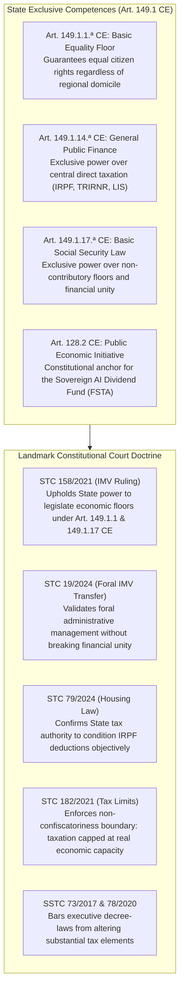
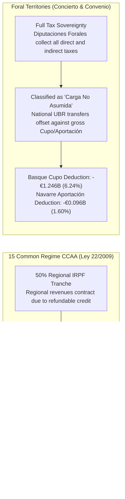

# Chapter 6 · Constitutional, Territorial, and EU Legal Blueprint: Common vs. Foral Regimes and Free Movement

---

## 1. Constitutional Competence Architecture in Spain’s Quasi-Federal State

Any national social policy reform in Spain must navigate the territorial distribution of competences established by the 1978 Constitution between the central State and the seventeen *Comunidades Autónomas* [@boe-ce-1978; @beramendi-2012-inequality]. Under Article 148.1.20.ª CE, Autonomous Communities hold exclusive competence over social assistance (*asistencia social*). Consequently, opponents of universal basic transfers frequently argue that a State-level unconditional transfer unconstitutionally invades regional social competencies.

As demonstrated by the legal competence matrix evaluated in Track 5, the Universal Basic Rent statute (*Anteproyecto de Ley*) rests upon four bedrock exclusive competencies of the central State:

### A. The Doctrinal Synthesis of STC 158/2021 and STC 19/2024
In **STC 158/2021** [@tc-stc-158-2021-imv], the Constitutional Court definitively resolved the competence challenge against the *Ingreso Mínimo Vital*, ruling that:
1. The exclusive regional competence over *asistencia social* does not preclude the State from establishing a non-contributory social security floor under **Article 149.1.17.ª CE** in conjunction with **Article 41 CE**.
2. The State is fully empowered under **Article 149.1.1.ª CE** to regulate basic living conditions guaranteeing the fundamental equality of all Spaniards.
3. In **STC 19/2024** [@tc-stc-19-2024-imv-foral], the Court further confirmed that delegating administrative management and payment to the historical foral institutions of the Basque Country and Navarre is constitutional, provided it respects the economic unity and financial coordination mechanisms of the *Concierto* and *Convenio*.

### Constitutional Anchors and Non-Usurpation Safeguard
To definitively insulate UBR against regional jurisdictional appeals, the statute is grounded in a triad of central constitutional titles:
- **General Economic Direction (Art. 149.1.13 CE) & Public Economic Initiative (Arts. 128.1 and 128.2 CE):** UBR is codified not as a palliative social assistance scheme, but as a structural macroeconomic stabilizer safeguarding aggregate demand and labor productivity during severe technological disruption.
- **Citizen Equality (Art. 149.1.1 CE) & State Finance (Art. 149.1.14 CE):** Guaranteeing identical baseline economic subsistence to all residents through an individual refundable tax credit in the IRPF.
- **Statutory Non-Usurpation Safeguard (*Cláusula de Salvaguarda Competencial Autonómica*):** Article 2 of the statute explicitly recognizes that Autonomous Communities retain exclusive jurisdiction to design, maintain, and supplement regional social assistance (*Rentas Mínimas de Inserción*, Art. 148.1.20 CE) as top-ups above the national citizen dividend floor, strictly respecting STC 158/2021 doctrine.

---

## 2. Asymmetric Fiscal Federalism: Common Regime CCAA vs. Foral Territories

Spain's asymmetric territorial finance is bifurcated between the **Common Regime** (15 Autonomous Communities governed by the *LOFCA* [@boe-lofca-1980] and *Ley 22/2009* [@boe-ley-financiacion-ccaa-2009]) and the **Foral Regime** (the Basque Country under *Ley 12/2002 del Concierto Económico* [@boe-concierto-vasco-2002] and Navarre under *Ley 28/1990 del Convenio Económico* [@boe-convenio-navarra-1990]). A uniform national cash transfer interacts with these two regimes in fundamentally distinct ways [@zabalza-lopez-laborda-2011]:

### A. The 15 Common Regime CCAA and the CPFF Fondo de Compensación UBR
Under *Ley 22/2009*, the central government cedes 50% of personal income tax revenues to regional governments. If the UBR refundable credit were subtracted from gross IRPF without financial compensation, regional tax receipts would contract, severely impairing regional budgets for healthcare, public education, and social services.

To guarantee absolute vertical and horizontal fiscal neutrality, Article 18 of the *Anteproyecto de Ley* amends *Ley 22/2009*, establishing the **Fondo de Compensación de la Renta Básica Universal** in the *Consejo de Política Fiscal y Financiera* (CPFF):
- **Fund Size in Scenario S2:** The central State allocates **€56.84 billion annually** to the Fund.
- **Horizontal Equalization:** Following the Zabalza & López-Laborda [@zabalza-lopez-laborda-2011] equalization formula, fund resources are distributed to ensure that every Common Regime Autonomous Community maintains an identical equalized net balance of **€1,134.8 per capita** (ranging from +€14.21B in Andalusia and +€7.84B in Catalonia to +€4.45B in Madrid and +€1.19B in the Balearic Islands).

### B. The Foral Regimes: Basque Concierto, Navarre Convenio, and Anti-Arbitrage Rules
The Basque Country and Navarre collect all direct and corporate taxes within their territories, paying an annual quota (*Cupo* in the Basque Country; *Aportación* in Navarre) to the central State to finance non-assumed competencies:
- **Statutory Classification:** Article 19 of the statute formally classifies the national UBR as a **non-assumed State competence (*carga no asumida*)**.
- **Financial Adjustment:** Because national UBR transfers are disbursed directly to foral residents by the central State or funded through non-concerted taxes (IECA), the gross foral quota is statutorily reduced:
  - **Basque Country (6.24% statutory coefficient):** The gross baseline Cupo of €1.480B is credited with a **-€1.246B non-assumed burden deduction**, resulting in an adjusted net Cupo of **€0.234B**.
  - **Navarre (1.60% statutory coefficient):** The gross baseline Aportación of €0.620B is credited with a **-€0.096B deduction**, resulting in an adjusted net Aportación of **€0.524B**.
- **The Mandatory Bilateral Tax Harmonization Accord (*Pacto Foral de Armonización*):** To eliminate the risk of domestic tax havens (where high-net-worth individuals transfer tax domicile to Foral provinces to evade national UBR clawback surcharges):
  1. Under the auspices of the *Comisión Mixta del Concierto* (Art. 61 Ley 12/2002) and *Comisión Negociadora del Convenio* (Art. 67 Ley 28/1990), Cupo deductions are statutorily conditioned on the enactment of reciprocal Foral UBR financing surcharges by the *Juntas Generales* and *Parlamento de Navarra*.
  2. *Five-Year Anti-Relocation Look-Back:* Modelled on Art. 72.3 LIRPF, taxpayers relocating tax residency from Common Regime CCAA to Foral territories remain subject to Common Regime UBR clawback rates for a transition period of five tax years.

---

## 3. European Union Law, Free Movement, and Non-Exportability

Under EU law, social cash transfers face scrutiny under Article 45 TFEU (free movement of workers), Directive 2004/38/EC (free movement and residence of Union citizens [@eu-dir-2004-38-free-movement]), and Regulation (EC) No 883/2004 (coordination of social security systems [@eu-reg-883-2004]).

Track 5 implements an airtight **Bifurcated EU-Law Architecture**:
1. **Special Non-Contributory Cash Benefit (SNCB) Listing under Regulation 883/2004 (Annex X):** To ensure total immunity from mandatory cross-border exportability (Art. 7 Reg. 883/2004), UBR is statutorily defined under EU law as a Special Non-Contributory Cash Benefit pursuant to Article 70 of Regulation 883/2004 and formally inscribed into Annex X. This legally guarantees that UBR is strictly non-exportable and payable solely to residents physically residing in Spain, fully conforming to CJEU jurisprudence (*Hosse*, *Stewart*).
2. **The Schumacker Tax Parity Protocol (Case C-279/93):** Under the CJEU *Schumacker* doctrine [@cjeu-c-279-93-schumacker], non-resident frontier workers who earn the major part of their income ($\ge 75\%$) in a Member State receive a pro-rata UBR tax credit proportional to their Spanish taxable labor income, excluding passive cross-border capital income.
3. **Objective EU Worker Thresholds & Anti-Abuse Standards:** In compliance with CJEU landmark rulings (*Lawrie-Blum* [@cjeu-c-66-85-lawrie-blum], *Genc* [@cjeu-c-14-09-genc], and *Dano* C-333/13), EU citizens engaged in genuine employment access UBR from month one. Economically inactive arrivals must establish 24-month continuous legal residency compliant with Article 7 of Directive 2004/38/EC (holding private resources and health insurance) before non-contributory entitlement can accrue.

---

## 4. Administrative Delivery, Digital Infrastructure, and Operational Resilience

Title V of the statute builds a high-capacity, privacy-preserving digital delivery infrastructure:

### A. The Cuenta Única Tributaria-Social and Master Taxpayer Index (MTI)
Operating as an interoperable digital spine between the *Agencia Estatal de Administración Tributaria* (AEAT), the *Instituto Nacional de la Seguridad Social* (INSS), and regional health services:
- **Master Taxpayer/Citizen Index (MTI/MPI):** Resolves identity discrepancies between NIE regularizations, Social Security numbers (*NAF*), and municipal records via cryptographic hash validation.
- **Asynchronous 90-Day Provisional Payment Buffer:** When data mismatches occur across regional health databases and AEAT, payments are never summarily suspended; instead, an automated provisional transfer is executed for up to 90 days while background systems reconcile records.
- **Predictable SEPA Clearing:** Cash disbursements are executed via automated SEPA credit transfers on the **1st calendar day of every month**.

### B. Anti-Fraud Residency Triangulation Protocol (*Protocolo de Residencia Triangulada*)
To defeat fictitious registrations (*empadronamiento fraudulento*) and ghost tenancies:
- Monthly disbursement is cross-validated across four independent administrative data spines: (1) active municipal Padrón entry with property cadastral reference; (2) domestic utility, water, or telecommunications geo-IP consumption footprints; (3) active Social Security contribution or health service interactions; and (4) annual AEAT tax declarations.
- Organized registration syndicates face severe criminal and administrative sanctions under reformed Articles 307 and 390 of the *Código Penal*.

### C. Financial Inclusion: Tarjeta Social Prepago UBR
For Spain's 1.4 million unbanked, elderly, or digitally excluded residents:
- *Sociedad Estatal Correos y Telégrafos* (Correos Cash) and the municipal social services network act as physical distribution agents.
- Beneficiaries receive the **Tarjeta Social Prepago UBR**, an offline, EMV-compliant rechargeable debit card issued directly by the Banco de España and Correos without requiring a commercial bank account or digital certificate.
- *Statutory AML Safe Harbor:* Transfers up to €1,200/month are statutorily exempt from commercial bank AML freezes under *Ley 10/2010*, backed by administrative fines for financial institutions that obstruct basic account access.

### D. Administrative Due Process & Fast-Track Arbitration
To prevent the judicial collapse of the *Juzgados de lo Social*:
- The statute creates the **Comisión Arbitral y Administrativa de la RBU**, a specialized electronic claims board resolving algorithmic and withholding disputes.
- *Positive Administrative Silence:* For individual claim disputes under €1,500 where the administration fails to issue a reasoned resolution within 45 calendar days, claims are automatically deemed approved, ensuring immediate liquidity protection for vulnerable claimants.
