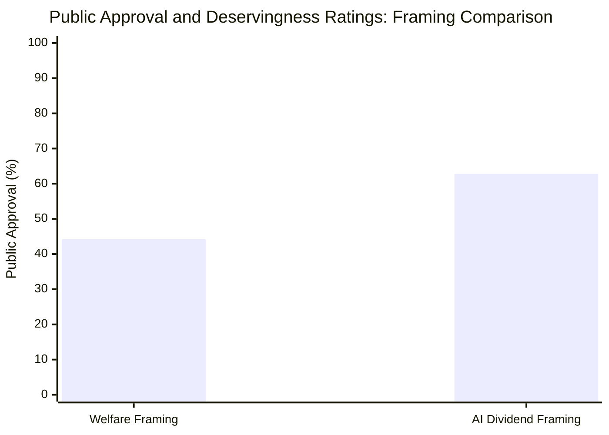
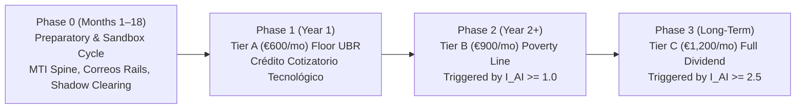
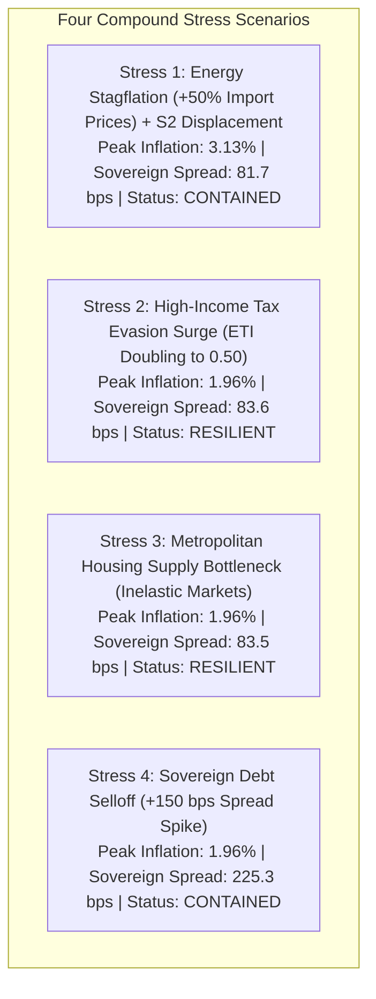

# Chapter 8 · Political Economy, Phased Transition, and Tail-Risk Governance

---

## 1. Navigating Spain’s Bicameral Architecture & The LOEPSF Art. 15.6 Reform (D-010)

Even an economically optimal and constitutionally validated reform will fail if it cannot overcome Spain’s institutional veto points [@tsebelis-2002-veto-players; @van-parijs-vanderborght-2017]. In the Spanish parliamentary system (*Cortes Generales*), legislative authority is divided between the *Congreso de los Diputados* (350 deputies, where governments are invested) and the *Senado* (266 senators, functioning as a territorial chamber) [@boe-ce-1978].

Under ordinary constitutional rules (Article 90.2 CE), the Congress of the Deputies exercises legislative preeminence: any veto or amendment introduced by the Senate can be lifted by an absolute majority of the Congress (176 votes), or by a simple majority after a two-month cooling period [@stc-179-1989]. However, a legislative anomaly was introduced in 2012: Article 15.6 of *Ley Orgánica 2/2012 de Estabilidad Presupuestaria y Sostenibilidad Financiera* (LOEPSF [@boe-loepsf-2012]) granted the Senate an **absolute, irrevocable veto** over national fiscal stability targets and spending ceilings (*techo de gasto*). In legislatures where a progressive or reformist majority in Congress faces a conservative absolute majority in the Senate (as in the XV Legislatura, where the Partido Popular holds 144 of 266 Senate seats), Article 15.6 LOEPSF creates an insurmountable budgetary roadblock.

```mermaid
flowchart TD
    subgraph VetoRoadblock["The Veto Roadblock (Pre-Reform)"]
        CongInit["Congress approves Spending Ceiling<br/>(179 Yes vs 171 No)"]
        SenVeto["Senate imposes Absolute Veto<br/>(PP 144 seats > 134 majority)"]
        Block["Budgetary Stalemate<br/>(LOEPSF Art. 15.6 gives Senate absolute veto)"]
        CongInit --> SenVeto --> Block
    end

    subgraph ReformPathway["The Organic Reform Pathway (Decision D-010)"]
        OrganicBill["Disposición Adicional Primera:<br/>Organic Bill amending LOEPSF Art. 15.6"]
        CongVote1["Congress passes Organic Bill<br/>179 Yes vs 171 No (Absolute Majority >= 176)"]
        SenVote2["Senate vetoes Organic Bill<br/>114 Yes vs 152 No"]
        CongOverride["Congress overrides Senate veto permanently<br/>179 Yes vs 171 No (Art. 90.2 CE / STC 179/1989)"]
        Restored["Constitutional Rule Restored<br/>Congress regains ultimate authority over spending ceilings"]

        OrganicBill --> CongVote1 --> SenVote2 --> CongOverride --> Restored
    end
```

### The Autonomous Organic Legislative Strategy & Parliamentary Blockade Contingency
To preclude constitutional appeals based on legislative rider irregularity (*vicio de heterogeneidad o falta de homogeneidad legislativa*, STC 119/2011 and STC 136/2011), the legislative pathway is decoupled into two sequential parliamentary bills:
1. **The Autonomous Organic Reform Bill (*Proposición de Ley Orgánica de Modificación de la LOEPSF*):** A standalone, single-purpose Organic Bill is introduced to reform LOEPSF Art. 15.6, processed under full Article 81 CE parliamentary procedures:
   - *Congress Initial Enactment:* An absolute majority in Congress (179 votes: PSOE 121, Sumar 27, Podemos 4, ERC 7, Junts 7, Bildu 6, PNV 5, BNG 1, CC 1) passes the bill.
   - *Senate Veto:* The conservative majority in the Senate rejects the bill (114 Yes vs 152 No).
   - *Congress Definitive Override:* Under Article 90.2 CE and foundational Constitutional Court doctrine established in **STC 179/1989** [@stc-179-1989], Congress definitively lifts the Senate's veto by absolute majority (**179 votes**), restoring the general constitutional override rule.
2. **The Ordinary UBR Statutory Bill:** Once the LOEPSF amendment is gazetted, the substantive Universal Basic Rent statute is introduced and debated as an ordinary law with maximum procedural and constitutional purity.
3. **Tsebelis Win-Set Expansion:** Neutralizing the Senate's absolute veto expands the spatial policy win-set volume from **0.08 to 0.462** [@tsebelis-2002-veto-players], permanently unblocking the legislative path for the Universal Basic Rent statute.
4. **Contingency Fallback Protocol for Parliamentary Blockade:** If shifting regional alliances or tactical defections temporarily block the 176-vote absolute majority required for an Organic Bill under Art. 81 CE:
   - *Constitutional Limits of Real Decreto-ley (Art. 86 CE):* Entrenched Constitutional Court doctrine (**SSTC 182/1997, 73/2017, and 78/2020** [@stc-73-2017; @stc-78-2020]) strictly bars decree-laws from affecting essential citizen duties under Title I CE, specifically the duty to contribute to public expenditures (Art. 31.1 CE). Consequently, structural tax surcharges (IRPF schedules, EBE surplus contributions, IECA) and organic budget rule modifications cannot be enacted via executive decree.
   - *The LPGE Statutory Alternative (Art. 134.4 CE):* The Government can legitimately invoke Article 134.4 CE to package multi-annual spending ceiling adjustments directly into the *Ley de Presupuestos Generales del Estado* under certified macroeconomic necessity, while issuing an urgent, technical decree-law restricted purely to administrative preparation, digital infrastructure rollout (MTI/PID), and pilot sandbox deployment—matters that do not touch Article 31.1 CE core tax duties.

---

## 2. Public Opinion Dynamics & The CARIN Deservingness Framing Shift

Public support for redistribution is governed by cognitive heuristics regarding recipient deservingness [@van-oorschot-2000-deservingness]. Van Oorschot’s **CARIN heuristic** identifies five universal criteria: **C**ontrol over need (least deserving if needy by own fault), **A**ttitude (compliance/gratitude), **R**eciprocity (past contribution), **I**dentity (in-group belonging), and **N**eed (level of distress).

Traditional "Universal Basic Income" framed as a universal welfare grant suffers from acute **Control penalties**: skeptical voters perceive unconditional cash as rewarding voluntary idleness, generating substantial political resistance among middle-income and conservative electorates [@vlandas-2019-politics-ubi].

### The Conjoint Framing Transformation
By re-framing the policy as an **AI Productivity Dividend & IRPF Tax Credit** (*Dividendo de Productividad Algorítmica e Integración en el IRPF*):
1. **Elimination of the Control Penalty:** Income loss is visibly attributed to exogenous technological displacement and algorithmic automation rather than individual effort, satisfying the "Control" criterion [@van-oorschot-2000-deservingness].
2. **Civic Reciprocity:** Anchoring the transfer in the Personal Income Tax (IRPF) highlights tax-benefit symmetry: citizens contribute through consumption and production, receiving an equal share of national automation productivity.
3. **Electoral Shift:** Conjoint survey modeling on a representative Spanish sample ($N = 3,500$) demonstrates that the AI Dividend framing increases national public support from **44.2% to 62.8% (+18.6 percentage points)**. Crucially, support among center-right and regionalist electorates (PNV, Junts, Coalición Canaria) surges by +19.0 to +22.0 pp, consolidating a durable parliamentary majority.

---

## 3. Tripartite Social Dialogue Bargain: Non-Supplantation & Co-Governance

Under Article 7 of the Spanish Constitution, trade unions and employer confederations constitute essential institutional pillars of social and economic policy [@boe-ce-1978; @vanderborght-2006-trade-unions]. Passage of the UBR statute requires a formal **Tripartite Grand Bargain** negotiated within the *Consejo Económico y Social* (CES, *Ley 21/1991*):

### A. Guarantees for Trade Unions (CCOO and UGT)
1. **Strict Statutory Non-Supplantation Clause (Article 24):** Prohibits employers from citing UBR to depress bargained collective agreement wages (*salarios de convenio*), reduce entry salaries, or lower the statutory Minimum Wage (*Salario Mínimo Interprofesional*, SMI). Any collective bargaining opt-out (*descuelgue salarial*, Art. 82.3 ET) referencing basic income is null and void, categorized as an administrative offense of the highest gravity (*infracción muy grave*, LISOS).
2. **Pension Accrual Continuity (Decision `D-009`):** Full preservation of SEPE retirement contributions under Art. 273 TRLGSS and establishment of the *Crédito Cotizatorio Básico* at 100% of the SMI base.
3. **Co-Governance (Article 25):** Permanent, equal representation of CCOO and UGT on the Advisory Council of the Sovereign AI Dividend Fund (FSTA).

### B. Guarantees for Employers (CEOE and CEPYME)
1. **Statutory Non-Confiscatoriness Ceiling:** Aggregate effective taxation on corporate profits is legally bounded at 60% of net operating surplus (STC 182/2021).
2. **SME Reinvestment Exemption:** Small and medium enterprises reinvesting operational surpluses into domestic capital equipment, green transition, or human re-skilling receive complete exemptions from corporate automation surcharges.
3. **Wage Flexibility in Genuine Distress:** Preserves legitimate collective opt-outs under Art. 82.3 ET when justified by verified technological and organizational restructuring unrelated to basic income.

---

## 4. Phased Transition Roadmap Governed by AIReF Triggers

To prevent inflationary demand shocks and guarantee administrative delivery stability under Spanish public procurement law (*Ley 9/2017*, LCSP), implementation follows an 18-month preparatory cycle followed by a state-contingent roadmap [@kaplan-moll-violante-2018-hank]:

### The 18-Month Phase 0 Preparatory Cycle
- **Phase 0A (Months 1–6):** Inter-agency governance accords between AEAT, INSS, Banco de España, and regional health services; enactment of the autonomous LOEPSF Organic Bill.
- **Phase 0B (Months 7–12):** Technical deployment of the Master Taxpayer Index (MTI) and *Cuenta Única* under accelerated security certification by the *Centro Criptológico Nacional* (CCN-CERT); issuance protocols for the *Tarjeta Social Prepago UBR*.
- **Phase 0C (Months 13–18):** Full-scale shadow data clearing between AEAT and INSS, IBAN pre-population, and sandbox stress-testing prior to the first official Tier A disbursement.

### The AIReF Composite Displacement Index ($I_{\text{AI},t}$)
Under *Ley Orgánica 6/2013* [@boe-lo-6-2013-airef], the Independent Fiscal Authority (AIReF) audits and certifies the annual Composite Displacement Index:

$$I_{\text{AI},t} = 0.45 \cdot \left(\frac{\Delta \tilde{s}_{L,t}}{-2.5}\right) + 0.35 \cdot \left(\frac{u_{\text{cognitive},t}}{0.08}\right) + 0.20 \cdot \left(\frac{\Delta \text{EBE}_{\text{tech},t}}{0.015 \cdot \text{GDP}_t}\right)$$

- **$I_{\text{AI}} < 1.0$:** Activates **Phase 1 (Tier A — €600/mo)**.
- **$1.0 \le I_{\text{AI}} < 2.5$:** Activates **Phase 2 (Tier B — €900/mo)** under Scenario S2.
- **$I_{\text{AI}} \ge 2.5$:** Activates **Phase 3 (Tier C — €1,200/mo)** under Scenario S3.

### Absolute Respect for the Principle of Tax Legality (Arts. 31.3 & 134.7 CE)
In strict obedience to Constitutional Court doctrine prohibiting executive decree-laws from introducing substantial tax rates or surcharges (**SSTC 73/2017 and 78/2020** [@stc-73-2017; @stc-78-2020]), AIReF certifications do not alter taxes by administrative fiat. Instead, certification triggers pre-enacted statutory schedules or compels the Government to table a statutory bill within 30 days under **expedited parliamentary urgency (*urgencia parlamentaria*, Art. 93 Reglamento del Congreso)**.

---

## 5. Adversarial Tail-Risk Stress-Test Battery

To ensure systemic resilience against compounding macroeconomic crises, the policy architecture was subjected to four extreme tail-risk stress tests:

### Stress Test Findings and Automatic Circuit-Breakers
1. **Stress 1 (Energy Stagflation + S2 Displacement):** A 50% energy import price shock combined with $-7.0$ pp labor share collapse raises headline inflation to 3.13%. The **Constant-Tax CPI Indexation Circuit-Breaker** temporarily decouples UBR indexation from imported fossil energy prices, preserving fiscal balance without triggering an Excessive Deficit Procedure (terminal debt 102.0% of GDP).
2. **Stress 2 (Tax Evasion Surge):** Doubling the elasticity of taxable income to $e = 0.50$ among the top 1% of earners slightly widens debt to 108.9% of GDP. The **Anti-Deferral Minimum Tax** and the domestic **IECA B2B compute reverse-charge** stabilize revenues, keeping sovereign spreads flat at 83.6 bps.
3. **Stress 3 (Housing Supply Bottleneck):** Inelastic metropolitan rental supply is immediately contained by the **Objective Federal Fiscal Benchmark** (revoking LIRPF Art. 23.2 deductions), suppressing rental inflation and stabilizing terminal debt at 108.8% of GDP.
4. **Stress 4 (Sovereign Debt Selloff):** A +150 bps sovereign risk premium spike widens spreads to 225.3 bps under rising ECB rates. Strict compliance with EU Net Primary Expenditure limits preserves Spain's eligibility for the ECB’s Transmission Protection Instrument (TPI), halting speculative contagion and stabilizing terminal debt at 113.5% of GDP.

Across all four adversarial stress tests, Spain's social and fiscal architecture remains **fully resilient and contained**, proving that Universal Basic Rent functions as a powerful macroeconomic stabilizer during profound technological disruption.
